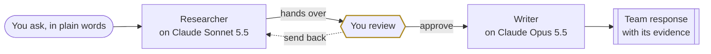
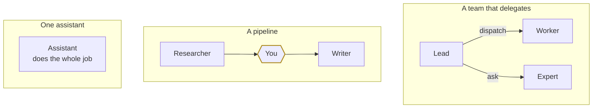

<p align="center">
  <picture>
    <source media="(prefers-color-scheme: dark)" srcset="docs/assets/readme/banner-dark.svg">
    
  </picture>
</p>

<p align="center">
  <a href="https://loomwatch.github.io"><strong>Website</strong></a> &middot;
  <a href="#quickstart"><strong>Quickstart</strong></a> &middot;
  <a href="#how-it-works"><strong>How it works</strong></a> &middot;
  <a href="#features"><strong>Features</strong></a> &middot;
  <a href="#teams-you-can-build"><strong>Recipes</strong></a> &middot;
  <a href="#try-your-first-run"><strong>First run</strong></a> &middot;
  <a href="#faq"><strong>FAQ</strong></a> &middot;
  <a href="#more-guides"><strong>Guides</strong></a>
</p>

<p align="center">
  
  
  
  
  
</p>

<p align="center">
  
  <br>
  <sub>The bundled offline demo: ask the team in its chat, approve the handover with a note, read the answer.</sub>
</p>

**Install on a Mac** (macOS 11 or newer; nothing else to install first): download
**[LoomWatch-macos.dmg](https://github.com/tnghia903/loomwatch/releases/latest/download/LoomWatch-macos.dmg)**,
open it, drag LoomWatch to Applications, and open it. Then follow
[Try your first run](#try-your-first-run). Rather use Terminal?

```sh
curl -fsSL https://loomwatch.github.io/install.sh | bash
```

**Install on Windows** (Windows 10 or 11, 64-bit; nothing else to install first): download
**[LoomWatch-windows-setup.exe](https://github.com/tnghia903/loomwatch/releases/latest/download/LoomWatch-windows-setup.exe)**
and open it. Rather use PowerShell?

```powershell
irm https://loomwatch.github.io/install.ps1 | iex
```

## Your agents are the threads. LoomWatch is the loom.

LoomWatch runs on your computer and opens in your browser. Build each agent once and try it on its
own, connect your agents into a workflow on a canvas, then give the team work in its chat and watch
their progress, tool calls, handovers and final answer in one place. Run a single agent, a
step-by-step pipeline, or a team that delegates work as it goes. When the team needs you, it stops
and asks.

<p align="center">
  <sub>ONE OPENROUTER KEY, MODELS FROM EVERY MAJOR AI COMPANY</sub><br>
  <strong>Claude</strong> &nbsp;·&nbsp; <strong>GPT</strong> &nbsp;·&nbsp; <strong>Gemini</strong> &nbsp;·&nbsp;
  <strong>DeepSeek</strong> &nbsp;·&nbsp; <strong>Kimi</strong> &nbsp;·&nbsp; <strong>Qwen</strong><br>
  <sub>with nothing else to install, and no AI app or subscription to sign in to</sub>
</p>

## How it works

<table>
<tr>
<td width="50%" valign="middle">
<picture>
  <source media="(prefers-color-scheme: dark)" srcset="site/assets/app/agents-dark.webp">
  
</picture>
</td>
<td width="50%" valign="middle">

### 01 &nbsp;Agents

**Build an agent** once: its job, the model it thinks with, its skills, and the keys it may use
without asking, such as the web or running commands. Pick it a face, **try it on its own**
with a real request, and save it to **Your agents**. Change its job later and it becomes the next
version; a team keeps the version it was given until you choose **Update**.

</td>
</tr>
<tr>
<td valign="middle">

### 02 &nbsp;Workflow

Put your agents in a team, or hire one by job, and connect who hands work to whom on a canvas.
LoomWatch reads the team back to you in **one plain sentence**, so you can check the plan before
anything runs.

</td>
<td valign="middle">
<picture>
  <source media="(prefers-color-scheme: dark)" srcset="docs/assets/readme/step-build-dark.png">
  
</picture>
</td>
</tr>
<tr>
<td valign="middle">
<picture>
  <source media="(prefers-color-scheme: dark)" srcset="docs/assets/readme/step-watch-dark.png">
  
</picture>
</td>
<td valign="middle">

### 03 &nbsp;Chat: ask, and watch

Each team has one chat. Write **@team** and the job in plain words: _"@team Prepare today's AI and
tech news digest, and link every claim."_ Each stage starts when the one before it hands over, and
what the agents tell each other shows in the chat as they say it. A note you write while an agent
works joins its next turn, each agent's status is said in words beside its face (_"Writing its
reply"_, _"Waiting for you"_), and every handover lands on a **live timeline** in Details that you
can drag back to replay.

</td>
</tr>
<tr>
<td valign="middle">

### 04 &nbsp;Review

A **You** step pauses the team, and the handover waits in the chat with **Approve** and **Send
back** on it. Approve it, or write what should change and send it back. **Nothing moves on until
you decide**, and the finished answer comes with the evidence to check before you use it.

</td>
<td valign="middle">
<picture>
  <source media="(prefers-color-scheme: dark)" srcset="docs/assets/readme/step-review-dark.png">
  
</picture>
</td>
</tr>
</table>

## LoomWatch is right for you if

- ✅ You want AI agents to **work on one job together**, without installing coding tools or signing
  in to an AI app.
- ✅ You want to **build an agent once, try it on its own**, and reuse it in every team that needs it.
- ✅ You want to **see what each agent did**, not just read a final answer: every tool call, file and
  handover is recorded.
- ✅ You want to **approve or redirect work** before the next agent builds on it.
- ✅ You want it **on your own computer**, with skills you add from skills.sh, ClawHub or GitHub, or
  bring in from the AI apps you already have.
- ✅ You run the same kind of job again and again, such as a daily digest or a research brief, and
  want it **repeatable, or scheduled**.

## What changes when your agents work as a team

| Without LoomWatch | With LoomWatch |
| --- | --- |
| You copy one chat's answer into the next chat's prompt. | Agents hand work to each other, and every handover is on the timeline. |
| You find out what an agent did by scrolling back through its terminal. | Every message, tool call and file it touched is recorded, and you can replay it. |
| A weak first step quietly shapes everything after it. | A review step stops the team until you approve, or send the work back. |
| Each AI app keeps its own skills and folders. | Skills and the folders and files you choose are delivered to the agents that need them. Take one off and it is turned off for that agent. |
| You set the same agent up again in every project. | Build it once in Your agents, try it on its own, and add it to any team. Teams keep their version until you choose Update. |
| Doing the job again means retyping the prompt. | One chat per team that remembers the conversation, **@** an agent to redo one step, and daily schedules. |

## How a run works



Each agent runs on LoomWatch's own agent, inside the program on your computer. It thinks with the
model you chose, reached through [OpenRouter](https://openrouter.ai) with your own key, and uses
LoomWatch's tools to read and write files in its folder, search the web and run commands, each only
as far as you allow. Agents can hand work to each other, or ask each other questions, through
LoomWatch's Team Bus. Every message, tool call and
handover is recorded in a local database, so you can watch a run live, replay it later, and follow
up from any step.

### Three ways to run a team



**One assistant** does the whole job. **A pipeline** runs its stages in order, each one receiving
the last one's handover, with review stops wherever you put them. **A team that delegates** starts
with a lead that hands out work and asks its teammates questions as it goes.

## Features

<table>
<tr>
<td width="33%" valign="top">

### 🧑‍🔧 Your agents

Build an agent once: its job, model, skills and the keys it may use. Try it on its own on a
test bench, then add it to any team. A new job makes a new version, and teams keep theirs until you
choose **Update**.

</td>
<td width="33%" valign="top">

### 🧶 A face for every agent

Pick each agent a figure from a sewing-box crew and a colour. It is the same on the canvas, in the
team sentence, in the chat and in Details, and it moves only as the run record says.

</td>
<td width="33%" valign="top">

### 🩺 Make it work better

Each agent's panel suggests what would help, read from the team file and its last five runs, each
with a one-click fix, and says about how many tokens a run uses.

</td>
</tr>
<tr>
<td valign="top">

### 🧵 One team, many models

Each agent thinks with its own model, chosen from hundreds on OpenRouter: Claude researches, GPT
checks, a free model drafts. Every run's receipt shows exactly what it cost.

</td>
<td width="33%" valign="top">

### 🗺️ Connect a workflow

Add agents from **Your agents** or hire them by job, connect them in order, and read your team back
as one plain sentence before anything runs.

</td>
<td width="33%" valign="top">

### 👀 Watch every step

Live stages, tool calls, each agent's status in words, a team chat of what the agents said to each
other, and a run receipt stamped with how the run ended and the tokens it used. Drag the timeline to
replay what happened, and when.

</td>
</tr>
<tr>
<td valign="top">

### ✋ You stay in the loop

Add a **You** step to approve the work or send it back with changes. Agents can also stop and ask you
a question mid-run, and when one asks to run a command you can change it first, or answer in its
place. In **Auto** mode, commands that only read or download run without asking.

</td>
<td valign="top">

### 🧾 Evidence you can check

A skill shows as loaded only when it was actually sent, and as opened only when the agent's own
stream read it. Nothing is guessed from a title.

</td>
<td valign="top">

### 🧰 Skills, folders and files

Add skills from skills.sh, ClawHub or GitHub, or copy in the ones your AI apps already have. Give an
agent any folder or file, PDFs included once `pdftotext` is installed (`brew install poppler`).
LoomWatch delivers each one to the agents you choose, and turns off what you take off the canvas.

</td>
</tr>
<tr>
<td valign="top">

### 🧠 Team memory

A **Brief** of shared instructions and files, and a **Notebook** of reusable notes and checkpoints
that carry from one run to the next.

</td>
<td valign="top">

### 💬 One chat per team

Write **@team** to start everyone, **@Writer** to ask one agent, or a note the team reads next time.
A note to an agent at work goes into its next turn, so it revises with everything it already has.

</td>
<td valign="top">

### ⏰ Schedules and Notion

Run a team every morning and send the answer to Notion. A review stop still waits for you. Give an agent a Notion page to read by dragging Notion onto it.

</td>
</tr>
<tr>
<td valign="top">

### 💬 Ask LoomWatch

Describe the team you want in a sentence. Ask sets it up on the canvas, on your OpenRouter key, and
nothing is saved until you click **Apply**.

</td>
<td valign="top">

### 🎓 Guided first run

An offline demo team and a three-minute guide. You can learn the whole app before you add a key.

</td>
<td valign="top">

### 🔒 Runs on your computer

The app, your teams, your run history and your key stay on this computer. Agents send their prompts
to the model you chose, through OpenRouter.

</td>
</tr>
</table>

## Teams you can build

Every team below is made of agents you build in **Your agents**, each starting from a job such as
Researcher or Writer, on the model its kind of work suits. Start from **New team** with the agents
you built, then add, connect and rename agents to match. To run a team on a schedule, ask
[Ask LoomWatch](#ask-loomwatch-to-set-up-a-team) to add one, or see [Routines](docs/WATCH.md#routines).

| Team | The steps | Good for |
| --- | --- | --- |
| **Morning briefing** | ⏰ Every day at 10:00 → Collector → Editor → Writer → Notion | A digest that is waiting when you start work |
| **Research team** | Lead → Researchers *(at the same time)* → Writer | A report on a big question, with a source cited for every claim |
| **Research and review** | Researcher → Reviewer | Answers whose sources a second agent has checked |
| **Approve before writing** | Researcher → ✋ **You** → Writer | Anything where a wrong first step is costly |
| **Code with a second opinion** | Coder → Reviewer *(another company's model)* → ✋ **You** | Changes in a folder, checked before you keep them |
| **From numbers to slides** | Analyst → Designer | A deck or page built from real data |

## See it

<table>
<tr>
<td align="center">
<picture>
  <source media="(prefers-color-scheme: dark)" srcset="site/assets/app/home-dark.webp">
  
</picture>
<br><sub><strong>Home.</strong> Your agents first, each with its face and version, then the teams they work in.</sub>
</td>
</tr>
<tr>
<td align="center">
<picture>
  <source media="(prefers-color-scheme: dark)" srcset="site/assets/app/workflow-dark.webp">
  
</picture>
<br><sub><strong>Workflow.</strong> Your agents on the canvas, connected in order and read back as one sentence.</sub>
</td>
</tr>
<tr>
<td align="center">
<picture>
  <source media="(prefers-color-scheme: dark)" srcset="site/assets/app/chat-dark.webp">
  
</picture>
<br><sub><strong>Chat.</strong> What the agents say to each other, your review, and the record one pane away in Details.</sub>
</td>
</tr>
</table>

## What LoomWatch is not

- **Not a chatbot.** It runs teams of agents, each with its own job, and shows you every step.
- **Not a cloud service.** It runs on your computer and keeps your run history there.
- **Not a model provider.** Your agents use models through your own OpenRouter key, and OpenRouter
  bills you for what they use.
- **Not autopilot.** You choose where the team stops for your review, and it waits for you.

## Quickstart

### The Mac app

1. Download **[LoomWatch-macos.dmg](https://github.com/tnghia903/loomwatch/releases/latest/download/LoomWatch-macos.dmg)**
   (about 30 MB, for Apple silicon and Intel Macs) and open it.
2. Drag **LoomWatch** to **Applications**, then open it from Applications.

LoomWatch opens in your browser with an offline demo team ready to run, and keeps an icon in the
menu bar: **Open LoomWatch**, **Start at login**, **Show log** and **Quit LoomWatch**. There is no
window to keep open; closing the browser tab leaves LoomWatch running until you quit it from the
menu bar. Then follow [Try your first run](#try-your-first-run).

> [!NOTE]
> LoomWatch is not notarized by Apple yet, so the first time you open it macOS may say it can't
> check it for malicious software. Click **Done**, open **System Settings › Privacy & Security**,
> scroll down, and click **Open Anyway** beside LoomWatch. macOS asks only once.

### The Windows app

1. Download **[LoomWatch-windows-setup.exe](https://github.com/tnghia903/loomwatch/releases/latest/download/LoomWatch-windows-setup.exe)**
   (for 64-bit Windows 10 and 11) and open it.
2. It installs LoomWatch for you alone (no administrator needed), adds it to the Start menu, and
   opens it.

LoomWatch opens in your browser with an offline demo team ready to run, and keeps an icon beside the
clock (click the **^** there if it is hidden). Click the icon to open LoomWatch; right-click it for
what waits on you, who is working and what finished in the last hour (click one to open it), and
for **Start at sign-in**, **Show log** and **Quit LoomWatch**. There is no window to keep open.
Then follow [Try your first run](#try-your-first-run).

> [!NOTE]
> LoomWatch is not signed with a code-signing certificate yet, so the first time you open the
> installer Windows may say it protected your PC. Click **More info**, then **Run anyway**.

### Or in Terminal

On a Mac (or Linux), paste this into Terminal:

```sh
curl -fsSL https://loomwatch.github.io/install.sh | bash
```

It downloads LoomWatch (about 21 MB, one program for Apple silicon and Intel Macs), checks it
against the release's checksum, puts it in `~/LoomWatch/app`, and opens
**<http://127.0.0.1:3000>** with an offline demo team ready to run. Nothing is compiled and no
administrator password is needed. Then follow [Try your first run](#try-your-first-run).

On Windows, paste this into PowerShell (from the Start menu, or Terminal) instead:

```powershell
irm https://loomwatch.github.io/install.ps1 | iex
```

It does the same with the Windows download, puts LoomWatch in `%USERPROFILE%\LoomWatch\app`, and
adds that folder to your own `PATH`, so any terminal window opened afterwards knows the `loomwatch`
command. If PowerShell says running scripts is disabled, run
`powershell -ExecutionPolicy Bypass -c "irm https://loomwatch.github.io/install.ps1 | iex"` instead.

> [!TIP]
> No OpenRouter key yet? The offline demo needs no key and calls no model, so you can learn the whole
> app first.

<details>
<summary>Rather read the installer before running it?</summary>

```sh
curl -fsSLO https://loomwatch.github.io/install.sh
less install.sh
bash install.sh
```

It is [scripts/install.sh](scripts/install.sh) in this repository. It downloads
`loomwatch-macos-universal.tar.gz` and its `.sha256` from the
[newest release](https://github.com/tnghia903/loomwatch/releases/latest), and changes nothing
outside `~/LoomWatch` apart from a `loomwatch` shortcut in `~/.local/bin` when that folder is
already on your `PATH`.

On Windows, `irm https://loomwatch.github.io/install.ps1 -OutFile install.ps1`, then
`notepad install.ps1`, then `powershell -ExecutionPolicy Bypass -File install.ps1`. It is
[scripts/install.ps1](scripts/install.ps1): it downloads `loomwatch-windows-x86_64.zip` and its
`.sha256`, and changes nothing outside `%USERPROFILE%\LoomWatch` apart from adding
`%USERPROFILE%\LoomWatch\app` to your own `PATH`.

</details>

LoomWatch runs on your computer as one program, and keeps your run history in one file there, so
your agents can work in the folders you give them.

### What you need

- **A Mac** with macOS 11 or newer, or **a Windows PC** with 64-bit Windows 10 or 11. Linux
  downloads exist for x86_64 and arm64 but are untested.
- **For real runs, an [OpenRouter](https://openrouter.ai) API key.** One key reaches models from
  Anthropic, OpenAI, Google and others, including some free ones. Make one at
  [openrouter.ai/keys](https://openrouter.ai/keys), add a few dollars of credit for the models that
  aren't free, and paste it into **Add your OpenRouter key** on Home. LoomWatch checks it with
  OpenRouter, then keeps it in this Mac's Keychain, or on Windows in Windows Credential Manager. You
  don't need a key for the demo.

LoomWatch never signs in to an AI app and never uses an AI subscription: no Claude, ChatGPT or Gemini
account is involved, and nothing else needs installing, not even for the offline demo.

> [!WARNING]
> On Windows, commands an agent runs are not sandboxed: an agent you let run commands can change
> any of your files. See [SECURITY.md](SECURITY.md).

### What the first start does

1. Creates your teams folder, `~/LoomWatch/teams`, with an offline demo team in it, if the folder
   does not exist yet.
2. Starts LoomWatch and opens **<http://127.0.0.1:3000>** in your browser.
3. Keeps your run history, notes and checkpoints in one file,
   `~/Library/Application Support/LoomWatch/loomwatch.db` (`%LOCALAPPDATA%\LoomWatch` on Windows,
   `~/.local/state/loomwatch` on Linux), so they survive restarts and reinstalling.

Coming from a version before 0.5, which kept the run history in Docker? Only 0.5.0 copies that
history into the file. Update to it first and start it once, with
`LOOMWATCH_VERSION=v0.5.0 ~/LoomWatch/app/loomwatch update`, then update again to the newest.

Started from Terminal, keep that window open while you use LoomWatch, and press
<kbd>Ctrl</kbd>+<kbd>C</kbd> in it to stop LoomWatch. The Mac app needs no window: quit it from its
menu-bar icon. Its log is in `~/Library/Logs/LoomWatch` (**Show log** opens it). The Windows app is
the same beside the clock, with its log in `%LOCALAPPDATA%\LoomWatch\Logs`.

Already used LoomWatch from Terminal? The Mac app uses the same teams and the same run history
file. If that copy still keeps its history in Docker, update it to 0.5.0 first, as above, so the
history is moved into the file. Only one LoomWatch can use the history at a time:
stop the Terminal one before opening the app.

LoomWatch reads no other app's settings or sign-ins. Your skills live in LoomWatch's own folder (see
[Where your work is saved](#where-your-work-is-saved)). On the Skills page, **Look on this computer**
copies in the skills your AI apps keep, and only when you click it.

### Every day

| To | Run |
| --- | --- |
| Start LoomWatch, or open it if it is already running | `~/LoomWatch/app/loomwatch` |
| Stop LoomWatch | Press <kbd>Ctrl</kbd>+<kbd>C</kbd> in its window, or run `~/LoomWatch/app/loomwatch stop` |
| Update to the newest release | **Update and restart** in the app, or `~/LoomWatch/app/loomwatch update` |
| Go back to the version the last update replaced | `~/LoomWatch/app/loomwatch rollback` |
| See which version you have, and whether a newer one is out | `~/LoomWatch/app/loomwatch version` |
| See every option | `~/LoomWatch/app/loomwatch help` |

When the installer added the `loomwatch` shortcut, plain `loomwatch` works too. Your teams and
history are kept in every case.

### Updating

**The Mac app and the Windows app:** when **Update available** shows, click it, then **Update and
restart**. LoomWatch asks first, naming any team still working, since updating stops it. Then it
saves a copy of your run history in `~/LoomWatch/backups/desktop-app`, downloads the new version,
checks it against the release's checksum, puts it in place of the one you have, and opens it
again; the page says when the new version is running. Your teams and history stay. If any step
fails, the version you had opens again and the page says why. The Mac app keeps the version it
replaced beside it, hidden, as `.LoomWatch.app.previous`.

The Mac app can't replace itself while it runs from the disk image or from Downloads, or from a
folder your account can't change; the window then says so and shows the steps to do it by hand:
download the new
[LoomWatch-macos.dmg](https://github.com/tnghia903/loomwatch/releases/latest/download/LoomWatch-macos.dmg),
quit LoomWatch from its menu-bar icon, drag the new one to Applications and choose **Replace**. On
Windows, the steps are to download the new
[LoomWatch-windows-setup.exe](https://github.com/tnghia903/loomwatch/releases/latest/download/LoomWatch-windows-setup.exe)
and open it; it closes LoomWatch, puts the new version in its place, and opens it again. Versions
0.6.3 and older of the apps don't have **Update and restart**: update those once by hand. The rest
of this section is about the Terminal install.

LoomWatch checks once a day, and again right after you update, whether a newer release is out.
When one is, Home shows **Update available** and the terminal running LoomWatch says so too. Click
it to read what changed and how to install it; <kbd>⌘</kbd><kbd>K</kbd> → **Check for updates…**
opens the same window at any time. Nothing is installed until you ask for it, in either of two ways:

- Click **Update and restart**. LoomWatch asks first, naming any team still working, since updating
  stops it. Then it stops, updates, and starts again in the same terminal window, and the page says
  when the new version is running. Keep that window open meanwhile.
- Or, in the terminal: press <kbd>Ctrl</kbd>+<kbd>C</kbd> in LoomWatch's window, then run
  `~/LoomWatch/app/loomwatch update` there.

Both first save a copy of your run history in `~/LoomWatch/backups` (the three newest copies are
kept; each is a database file you can open). Then they download the release, check it against the
release's checksum, and start it. If
any step fails, the version you had stays as it was, and the terminal says why; after **Update and
restart**, it also starts again and the app says why.
Run `update` while LoomWatch is running and it asks before stopping it. Already on the newest
release, it only starts LoomWatch.

**Update and restart** is there when LoomWatch was started with `~/LoomWatch/app/loomwatch` (or
`loomwatch`), which stays beside it to start it again. Versions 0.1.9 and older don't have it: update
those once in the terminal.

The version an update replaced is kept. If the new one gives you trouble,
`~/LoomWatch/app/loomwatch rollback` puts it back. When the newer version changed how the run
history is stored, the older one cannot read it, so `rollback` also puts back the copy saved before
the update. It asks first, and saves what you recorded since in another copy. Going back to a
version that kept the run history in Docker finds that history there, as the update left it; what
you ran since stays in the file. To install one particular release, run
`LOOMWATCH_VERSION=v0.1.4 ~/LoomWatch/app/loomwatch update`.

The daily check asks GitHub for the newest version number and sends nothing about you, your teams
or your runs. Turn it off in the **Check for updates** window, or for good on this computer with
`LOOMWATCH_UPDATE_CHECK=off`. Running the install command again also updates LoomWatch, without
the copy of the run history.

To stop one run, click **Stop** beside the request box. Closing the browser tab does not stop LoomWatch or
its runs. Scheduled teams run only while LoomWatch is running and the computer is awake. For scheduled runs and optional Notion delivery, see [Routines](docs/WATCH.md#routines) and
[Notion setup](docs/NOTION.md).

### Remove LoomWatch

**The Mac app:** turn off **Start at login** in its menu, choose **Quit LoomWatch**, and drag
LoomWatch from Applications to the Trash. Your teams and history stay where steps 4 and 5 below
say; delete those folders, and `~/Library/Logs/LoomWatch`, to leave nothing behind. **The Windows
app:** remove LoomWatch in **Settings › Apps › Installed apps** (it quits LoomWatch first and turns
off Start at sign-in). Your teams stay in `%USERPROFILE%\LoomWatch` and your history in
`%LOCALAPPDATA%\LoomWatch`; delete both to leave nothing behind. The steps below are for the
Terminal install.

1. Remove your OpenRouter key: choose **Connections…** from the ☰ menu and click **Remove key**
   under **AI models**. Otherwise it stays in your Keychain as `LoomWatch.OpenRouter` (on Windows,
   in Windows Credential Manager). To stop it
   working anywhere, delete the key at [openrouter.ai/keys](https://openrouter.ai/keys) too.
2. Stop LoomWatch: `~/LoomWatch/app/loomwatch stop`.
3. Delete the program: `rm -rf ~/LoomWatch/app`, and `rm ~/.local/bin/loomwatch` if the installer
   made that shortcut.
4. Your teams are kept in `~/LoomWatch/teams` until you delete `~/LoomWatch` too. It also holds Your
   agents, deleted teams, the agents' working folders, and in `backups` the copies of your run
   history that updates saved.
5. Your run history, Notebook entries and Ask conversations, your skills, which teams you approved
   to run, and your update-check choices are in `~/Library/Application Support/LoomWatch`
   (`~/.local/state/loomwatch` on Linux). Delete that folder too to leave nothing behind.

For a copy built from source, run `./loomwatch stop` in its folder, then delete the folder: its run
history is inside it, in `.loomwatch/`.

If you used a version that kept the run history in Docker, its database is still there. Delete it,
once you no longer need it, with `cd ~/LoomWatch/app && docker compose down -v` before step 3 (or
in Docker Desktop, the `loomwatch-app_postgres-data` volume).

On Windows the steps are the same, in PowerShell: remove the key first, `loomwatch stop`, then
delete `%USERPROFILE%\LoomWatch\app` and remove that folder from your `PATH` (Start menu, "Edit
environment variables for your account"). Your run history and LoomWatch's approvals are in
`%LOCALAPPDATA%\LoomWatch`. The OpenRouter key and a Notion sign-in are kept in Windows Credential
Manager under LoomWatch's name.

### Change the defaults

| Setting | Default | For example |
| --- | --- | --- |
| Browser port | `3000` (or `LOOMWATCH_PORT` in `.env`) | `LOOMWATCH_PORT=3001 ~/LoomWatch/app/loomwatch` |
| Teams folder | `~/LoomWatch/teams` | `LOOMWATCH_TEAMS_ROOT=~/Work/teams ~/LoomWatch/app/loomwatch` |
| Run history file | `~/Library/Application Support/LoomWatch/loomwatch.db` | `LOOMWATCH_DATABASE=~/Work/loomwatch.db ~/LoomWatch/app/loomwatch` |
| Install folder | `~/LoomWatch/app` | `curl -fsSL https://loomwatch.github.io/install.sh \| LOOMWATCH_APP_DIR=~/Apps/LoomWatch bash` |
| Version | The newest release | `curl -fsSL https://loomwatch.github.io/install.sh \| LOOMWATCH_VERSION=v0.1.0 bash` |
| Copies of the run history saved by `update` | `~/LoomWatch/backups` | `LOOMWATCH_BACKUP_DIR=~/Backups/LoomWatch ~/LoomWatch/app/loomwatch update` |
| Daily check for a newer version | On | `LOOMWATCH_UPDATE_CHECK=off ~/LoomWatch/app/loomwatch`, or turn it off in **Check for updates** |

`loomwatch --no-open` starts without opening the browser, and `loomwatch help` lists everything.
In PowerShell, set a setting for one start like this: `$env:LOOMWATCH_PORT=3001; loomwatch`.

### Build from source

To change LoomWatch, or to run the newest code on `main`, build it yourself. That needs Git,
[Node.js](https://nodejs.org/) 22.12 or newer and [Rust](https://rustup.rs/); the exact Rust
version downloads on its own during the first build. With Homebrew:

```sh
brew install node
curl --proto '=https' --tlsv1.2 -sSf https://sh.rustup.rs | sh -s -- -y
```

Open a new terminal window so it finds the new tools, then:

```sh
git clone https://github.com/tnghia903/loomwatch.git
cd loomwatch
./loomwatch
```

On Windows, install Git, Node.js and Rust (`winget install Git.Git OpenJS.NodeJS.LTS
Rustlang.Rustup`, and let Rust's installer add the Visual Studio C++ build tools it asks for), then
run `.\loomwatch.cmd` in the cloned folder wherever this guide says `./loomwatch`.

The first start builds the browser app and the program, which takes a few minutes, then does what
the installed copy does. Use `./loomwatch` from that folder wherever this guide says
`~/LoomWatch/app/loomwatch`. In a copy of the source, `./loomwatch update` pulls the newest `main`,
saves a copy of the run history when anything changed, and rebuilds; `rollback` is for installed
copies, since Git keeps every version of yours. `./loomwatch --rebuild` builds again even when
nothing changed. `main` moves faster than the releases, so expect rough edges. A copy of the source
keeps its own run history in `.loomwatch/loomwatch.db` inside its folder, apart from the installed
app's. A history it kept in Docker before 0.5 is copied in only by 0.5.0: run
`git checkout v0.5.0 && ./loomwatch` once first.

<details>
<summary>What <code>./loomwatch</code> runs, if you prefer to do it by hand</summary>

```sh
(cd ui && npx --yes pnpm@12 install --frozen-lockfile && npx --yes pnpm@12 run build)
cargo build --release --locked --bin loomwatchd
mkdir -p "$HOME/LoomWatch/teams"
cp -n examples/operator-stop.yaml "$HOME/LoomWatch/teams/"
./target/release/loomwatchd serve --teams-root "$HOME/LoomWatch/teams" --listen 127.0.0.1:3000 \
  --database .loomwatch/loomwatch.db
```

The browser app is built before the program because it is packed into it. `loomwatchd backup <file>`
saves a copy of the run history, safely while it runs.

</details>

## Try your first run

The first time you open LoomWatch, a short guide offers to walk you through building your first
agent, trying it on its own, putting it in a team and running it on your OpenRouter key.
Reopen it any time with **New here? Take the 3-minute guide** on Home, from the menu in a team, or
by pressing <kbd>⌘</kbd><kbd>K</kbd> and choosing **Getting started guide**.

To try a team without calling a model provider, pick **Review stop demo** under **Your teams**. The
demo is a three-step workflow: **Researcher → You → Writer**. Its agents produce fixed responses so
you can learn the interface without calling a model provider.

1. Open the team's **Chat** tab (or click **Run team** in **Workflow**), type
   `@team Prepare a short getting-started guide for new users.` in the message box at the bottom,
   and press <kbd>Enter</kbd> (<kbd>Shift</kbd>+<kbd>Enter</kbd> adds a new line). Only a message
   with an **@** starts work; the box says where each message goes before you send it.
2. When the team pauses for you, the chat shows what Researcher handed over, with **Approve** and
   **Send back to Researcher** under it.
3. To ask for changes, type `Use the short guide and remove the detailed walkthrough.` in the box
   and click **Send back to Researcher**. The researcher revises its work and asks again.
4. Click **Approve** to let the team continue. To pass on a note, type it first; the button then
   says **Approve with your note**, and your note goes on as your direction.
5. Read the team's answer in the chat. The demo writer echoes the direction it received.

Everything the team has done stays in its chat: scroll up, or search it with the magnifier at the
top. **Details** on any piece opens its stages, timeline and record beside the chat, and **Full
trace** there has the replay slider. To change one step's work, write **@** and that agent's name
with what should change; under its new version, **Continue with the team** runs the steps after it.

## Run your own agents

1. Add your OpenRouter key: paste it into **Add your OpenRouter key** on Home, or under **AI models**
   in **Connections…** (☰ menu). LoomWatch checks it with OpenRouter and shows how much credit is
   left on it.
2. Click **Build an agent** on Home. Give it a name and its instructions, choose its model and how
   hard it thinks, pin up the skills it needs and hand it the keys it may use without asking. Pick it
   a face, then **Try it** with a real request: it runs on your key, and asks you before it uses a
   key it wasn't given. **Save to Your agents** when it does the job.
3. Click **New team**, give it a name and choose the agents it starts with. A team always starts
   with at least one:
   - **Your agents** — tick the agents you built; each joins as the version you saved (recommended
     once you have one).
   - **One assistant** — a single agent that does the whole task (recommended to begin with).
   - **Researcher and writer** — one agent gathers facts, a second writes the result.
   - **Research, write and check** — a third agent, on another company's model, checks the finished
     piece against what it must have.
   - **Research, your approval, then writing** — the team pauses so you can approve the research.
   - **Research team** — a lead splits your question, researchers look into each part at the same
     time, and a writer turns what they found into a report that cites every source.

   Ready-made teams are saved straight away, each agent on the model its job suits, so you can run
   them immediately.
4. A team has three tabs: **Agents**, **Workflow** and **Chat**. On **Agents**, click **Add an
   agent** to bring in one from Your agents. On **Workflow**, add more from **Your agents** in the
   panel on the left; to make a new one, choose **Build a new agent** and start from a job such as
   Researcher or Writer. Select a card to edit its name, instructions, model and how hard it
   thinks. Drag from the dot on a card's right edge to the next card to make them work in order, and
   add **You (review step)** wherever you want to approve work before the team continues.
5. Click **Run team**, or open **Chat**, describe what you want in plain words, and press
   <kbd>Enter</kbd>.

Each agent's model is an OpenRouter model id, such as `anthropic/claude-opus-5.5`. The model picker
recommends a short list, marks the free ones **Free**, and searches the rest of OpenRouter's
catalogue. New agents start on Claude Opus 5.5; the jobs that gather facts start on the faster Claude
Sonnet 5.5, and a check step on another company's model, so the work is read by a model that didn't
write it.

> [!IMPORTANT]
> OpenRouter bills real runs to your key, at each model's price, and each run's receipt shows what
> it cost. Your request, the agents' instructions and the files and pages they read go to OpenRouter
> and the company whose model you chose. Running LoomWatch locally does not make cloud models
> offline. Free models change often, and some let their maker learn from what you send, so keep
> private work for a model you pay for. The offline demo calls no model.

<details>
<summary><strong>Keep the pipeline easy to follow</strong></summary>

Choose **Organize** from the ☰ menu at the top right (or press <kbd>⌥</kbd><kbd>⌘</kbd><kbd>L</kbd>,
or choose **Organize pipeline** in <kbd>⌘</kbd><kbd>K</kbd>) to arrange stages from left to right
and group skills and sources below their agents. The view then fits the arranged team. **Undo
organize**, in the same menu, restores the previous arrangement. Positions are saved with the canvas
layout; organizing does not change the workflow or start a run.

</details>

<details>
<summary><strong>Connect skills, knowledge and tools</strong></summary>

The add panel on the left of **Workflow** lists your skills and the teams whose memory you can
share. **Manage skills** opens the Skills page, where you add more: search skills.sh and ClawHub at
once, paste a GitHub link, or copy in the skills your AI apps already have. Each one shows its
license and what it needs before anything is copied, and nothing in it runs when it is added. Add a
skill to the canvas, then drag from an agent to it, or
open the card's **Details & connections** and tick the agents that should use it. To give an agent
a folder or a file, select the agent and click **Folder** or **File** under **Given** in its
**Context**. Save the team, and the next run delivers it:

- A **skill** is copied into the agent's working folder, and the agent is told to read it in full
  before it starts. Every agent also sees the name and purpose of each skill in LoomWatch, and reads
  one when its work calls for it.
- A **folder or file** is given to the agent as reference material: a folder's listing and README,
  or a file's text. A PDF's text is read when `pdftotext` is installed (`brew install poppler`).
  The agent can also read the folder or file itself. An added file can be up to 25 MB; link a
  folder for anything bigger.
- A **tool** you connected, such as Todoist or Kiwi.com, lets the agent use that service. Connect one
  in the agent's **Tools it can use** block or in Connections; the agent asks you before each action
  it takes there, unless you always allow that action. See [Give agents tools](docs/TOOLS.md). A tool from an AI app's own settings is
  not given to LoomWatch's agents: an agent that still names one is told it isn't there, and the run
  carries on without it.

Taking a skill card off the canvas, or the line from it to one agent, **turns it off** for that
agent. The agent's **Context** lists what is turned off, with a button to turn each back on. When an
agent's instructions still name what you removed, LoomWatch marks it, and **Rewrite with** Ask's
model drops or rewrites just those sentences as one edit you can keep or put back.

If something cannot be delivered (for example, a skill that is no longer in LoomWatch's skills),
the run stops before it starts and says what to change. If an older team shows "drawn but not
delivered to agents yet" at the top of Workflow, click **Deliver on the next run**, then save.

</details>

<details>
<summary><strong>Give the team context and review its work</strong></summary>

Choose **Team memory** from the ☰ menu to add shared instructions or reference files to the
**Brief**. Use the **Notebook** to review reusable notes and checkpoints.

Select an agent in Workflow to see its **Context**: its place in the team (for example "Step 2 of 3 ·
after Researcher · hands its work to Writer"), the team Brief, and every skill, folder, file and
tool connected to it, each with an × to disconnect it. In a team of two or more, each agent is told
its place at the start of every run. In the Run view, an agent's **What this agent received** link
(**What it was given** on its card in Full trace) shows what it was supplied when its session
started.

For a review checkpoint in a pipeline, add a **You** step between two agents and say what to look
at in its **What to check** box. **Approve** passes the work on (it says **Continue** once you
type a note, and your note goes with it). **Send back to** the agent asks for a revision while its
session is still open. An agent can also ask you a question mid-run: type your answer in the
request box and click **Reply**.

</details>

## Ask LoomWatch to set up a team

Click **Ask** at the top of any screen (or press <kbd>⌘</kbd><kbd>J</kbd>), or type in **Or describe
the job** on Home. Say what you want in plain words, such as _"Every weekday at 8, brief me on AI
news"_. Ask sets the team up on the canvas. New and changed agents are marked,
and nothing is saved until you click **Apply**; **Discard** drops the proposal, and **Undo** takes
an applied one back.

- **It asks before it runs.** When it wants to start a run, it waits for you to click **Start run**,
  unless you turn off **Ask me before starting a run**.
- **It never answers a review step.** It can put a drafted note in the review box; only you click
  **Approve** or **Send back**.
- **You choose the model.** Ask runs on LoomWatch's own agent with your OpenRouter key, and the
  panel names its model. Click the name to pick another. Each conversation is billed to your key,
  like a run. Without a key, the panel asks you to add one.

## FAQ

<details>
<summary><strong>Do I need an account or an API key?</strong></summary>

For real runs, yes: an OpenRouter API key, which you make at
[openrouter.ai/keys](https://openrouter.ai/keys). LoomWatch itself is free and has no account. It
never signs in to an AI app, never uses an AI subscription and never reads another app's sign-ins:
every model call goes through LoomWatch's own agent with your key. The key stays in this Mac's
Keychain (on Windows, in Windows Credential Manager; on Linux, in a file only your user can read),
and agents never see it: it is not in their
commands, their folders, the team file or the run history.

The offline demo needs no key at all, and some models on OpenRouter are free. Free models change
often, and some let their maker learn from what you send, so keep private work for a model you pay
for.

</details>

<details>
<summary><strong>What does a run cost?</strong></summary>

OpenRouter bills your key for each model call, at that model's price. Each run's receipt shows the
exact cost OpenRouter reported. The offline demo costs nothing.

</details>

<details>
<summary><strong>Is my work sent anywhere?</strong></summary>

LoomWatch serves everything on `127.0.0.1` and keeps your run history in a file on this computer.
What an agent works with (its instructions, your request, and the files and pages it reads) goes to
OpenRouter and the company whose model it uses, as with any AI service. Skills are fetched from
skills.sh, ClawHub or GitHub only when you add one.

</details>

<details>
<summary><strong>Can different agents in one team use different models?</strong></summary>

Yes. Each agent card has its own model and effort. A team can research on Claude Sonnet, check on
GPT and draft on a free model such as DeepSeek or Qwen, all through the one OpenRouter key.

</details>

<details>
<summary><strong>What happens when an agent asks for permission to do something?</strong></summary>

LoomWatch decides, for every agent. Each agent's panel in **Workflow** has three switches under **Allowed
without asking**: **Search the web**, **Edit files** (only in the agent's own folder) and **Run
commands**. They start off, except **Search the web** for researchers. LoomWatch always allows the
team's own handovers and the tools, folders and files you connected to the agent.

Anything else waits for you. The agent pauses and asks in the team chat, as its own message, such
as "Asks to use the web · Web search · …". You answer right below it: **Allow**, **Allow for this
run**, **Allow for the whole team** (every agent in this run may use that tool without asking),
**Always allow** (which switches it on for that agent) or **Deny**. For a command, **Edit, then
allow** lets you change it before it runs, this once, and **Answer instead** sends the agent your
reply in place of what it asked to do, so nothing runs. The chat keeps how it ended, such
as "You allowed it, this once". The same question shows up in the Needs-you tray from
any screen. If nobody answers within 10 minutes it is declined, and scheduled runs decline it
straight away because nobody is watching.

To ask less often, switch the team to **Auto** beside the chat's message box (**Commands · Ask me**
→ **Auto**), or set `permissions: {mode: auto}` in the team file. A command an agent isn't allowed
to run on its own then runs without asking when every part of it only reads inside the agent's
folder, its knowledge or the temp folder, or is a plain download for an agent allowed the web.
Anything that deletes, pushes, publishes, deploys, needs admin rights, touches credentials or runs a
script given as text always asks, and so does everything else, with the reason on the card.
LoomWatch decides this on your computer from the command itself; no model is asked and nothing is
sent anywhere.

The run records every request and who answered it. When something was declined, the run receipt says
what the agent couldn't do and offers **Allow from now on**.

LoomWatch's agents have no tools that publish, post or message outside the run: they read and write
files in their folder, search and read the web, run commands, and talk to their team. An agent you
allow to run commands or use the web can still reach the internet. Your team's answer leaves
through your review and the delivery you set up, such as **Send every answer to Notion**.

</details>

<details>
<summary><strong>Is it safe to run a team someone shared?</strong></summary>

A team file says what each agent is told, which model it runs on, what it may do without asking,
which folders it works in and when it runs, so treat one from someone else with care. LoomWatch
helps you check it. The first time you run a team that wasn't built in LoomWatch, or that changed
outside it, LoomWatch shows what it will do before anything starts:

- which model each agent runs on;
- what each agent may do without asking;
- the folders it can read;
- whether it runs on a schedule.

Choose **Trust and run** only if you trust where it came from. Until then its schedule does
nothing. A team file can't start a program of its own: a program an older team file names is never
run. See [SECURITY.md](SECURITY.md) for what LoomWatch does and doesn't
protect against.

</details>

<details>
<summary><strong>Can I run it on a server, or entirely in Docker?</strong></summary>

Yes. See [Run everything with Docker Compose](#optional-run-everything-with-docker-compose). The
recommended desktop setup runs LoomWatch itself on your computer, so agents can work in your own
folders.

</details>

## Optional: run everything with Docker Compose

Use this mode for CI, demos, or an intentionally isolated Linux deployment. It is not the
recommended desktop setup: agents in the container can only work in the folders mounted into it.

<details>
<summary>Set up the Compose stack</summary>

To change a default, copy the settings file with `cp .env.example .env` and edit it. Then create a
repository-local teams folder, and build and start the stack:

```sh
mkdir -p teams
cp -n examples/operator-stop.yaml teams/
docker compose up --build --detach --wait
```

Open the [offline review-stop demo](http://127.0.0.1:3000/?path=operator-stop.yaml). The UI is
embedded in the `loomwatch` image, the run history, context packets, Notebook entries and
checkpoints are one SQLite file in the `loomwatch-home` volume, and the app is published only on
host loopback. To stop, finish or stop active runs, then run `docker compose stop`: it preserves
the volume, and `docker compose up --detach --wait` resumes the stack.

The defaults mount these explicit roots:

| Container path | Default host path | Access | Purpose |
| --- | --- | --- | --- |
| `/data/teams` | `./teams` | Read/write | Team YAML, Brief files, layouts, and managed `.loomwatch` workspaces |
| `/workspaces` | `./container/workspaces` | Read/write | Repositories used by container-native agents |
| `/home/node` | `loomwatch-home` volume | Read/write | The run history, your OpenRouter key and LoomWatch's skills |

</details>

<details>
<summary>Your key and skills in the container</summary>

Add your OpenRouter key in the browser as on a Mac. In the container it is kept in `keys.json` in
LoomWatch's state folder, inside the `loomwatch-home` volume, readable only by LoomWatch's user, and
the skills you add on the Skills page are kept in the same volume. The image includes Node.js,
Python, Git and curl, for skills whose scripts need them.

Team files running against a mounted repository should use a path below `/workspaces`. Absolute
host paths such as `/Users/name/project` do not exist inside the Linux container.

</details>

## Where your work is saved

| Data | Location in this guide |
| --- | --- |
| Team definitions and canvas layouts | `~/LoomWatch/teams`; Compose-only deployments use `LOOMWATCH_TEAMS_DIR` |
| Brief files | Paths configured by the team, usually beside its YAML file |
| Deleted teams | `.trash` inside your teams folder, one folder per deleted team |
| Your agents | `.jobs` inside your teams folder, one `<agent>.yaml` per agent. Earlier versions are in `.jobs/.versions/<agent>/`, removed agents move to `.jobs/.removed`, and the one-agent teams that **Try it** runs are in `.jobs/.bench` |
| Files you add to an agent (**File** under **Given**) | `<team>.files/` beside the team file |
| Agents' working folders, and Ask's | `.loomwatch/` inside your teams folder |
| Your OpenRouter key | This Mac's Keychain, as `LoomWatch.OpenRouter`. On Windows, Windows Credential Manager, as `api-key.LoomWatch.OpenRouter`. On Linux and in Compose, `keys.json` in LoomWatch's state folder, readable only by your user |
| Your skills | `skills/` in `~/Library/Application Support/LoomWatch` (`%LOCALAPPDATA%\LoomWatch` on Windows, `~/.local/state/loomwatch` on Linux), and where each one came from in `skills.json` beside it. Skills that travel with a team are in `.agents/skills` beside its file |
| Team chats (your messages and every run), recorded events, Notebook entries and Ask conversations | One file, `loomwatch.db`, in `~/Library/Application Support/LoomWatch` on macOS, `%LOCALAPPDATA%\LoomWatch` on Windows or `~/.local/state/loomwatch` on Linux. A copy of the source keeps its own in `.loomwatch/` in its folder; Compose deployments in the `loomwatch-home` volume. |
| Which team files you approved to run, and your update-check choices | `~/Library/Application Support/LoomWatch` on macOS, `%LOCALAPPDATA%\LoomWatch` on Windows, `~/.local/state/loomwatch` on Linux |
| Copies of the run history saved by `loomwatch update`, and by **Update and restart** in the Mac and Windows apps | `~/LoomWatch/backups`, one folder per copy of LoomWatch (`desktop-app` for the apps), the three newest in each |
| The version the last update replaced, for `loomwatch rollback` | `.previous` in `~/LoomWatch/app`. The Mac app keeps it beside itself, hidden, as `.LoomWatch.app.previous`: rename it back to `LoomWatch.app` to go back |

Back up your teams folder and the run history if you want to move or preserve your work. Copy the
history while LoomWatch runs with `~/LoomWatch/app/bin/loomwatchd backup ~/loomwatch-copy.db`, or
copy `loomwatch.db` while it is stopped.

> [!WARNING]
> In Compose mode, avoid `docker compose down -v` for normal shutdown: it deletes the
> `loomwatch-home` volume, including the run history and Notebook entries.

<details>
<summary>Deleting and restoring a team</summary>

To delete a team, choose **Delete team…** from its **…** menu on Home or from the team switcher.
LoomWatch refuses while the team is running, or while another team reads its memory. Nothing is
erased. The team file, its layout, its own notes folder (`<team>.brief`) and the folder of files
added to its agents with **Add file…** (`<team>.files`) move to `.trash/<date>-<team>/` inside your
teams folder; `moved` in that folder's `deleted.json` lists which of them the team had. Its run
history and Notebook entries stay in the run history, and no new team takes its file name while it is
in the trash. To restore it, move everything in that folder except `deleted.json` back to the
folder where `path` in `deleted.json` says the team file was. `<team>.files` must go back too, or
its agents lose the files added to them. In Finder, press <kbd>⌘</kbd><kbd>⇧</kbd><kbd>.</kbd> to show hidden folders. To remove a team for good,
delete its folder from `.trash`.

</details>

<details>
<summary>Reusing an agent with Your agents</summary>

Build an agent in **Your agents** (**Build an agent** on Home), or keep one that works in a team:
select it and choose **Add to Your agents**. It appears under **Your agents** in every team's add
panel, with its instructions, model, skills and what it may do without asking.

Placing it copies that version into the team, so a team runs exactly what it was approved with.
Saving a change to what a team copies, such as its job, makes the next version and keeps the
earlier ones; a new face keeps the version. The agent's panel in a team says when a newer version
is ready and offers **Update to v…**, **Edit in Your agents**, or **Make it this team's own** to
change it there alone. The builder lists the teams that use the agent and the version each one has.
Removing an agent from Your agents leaves the teams' copies alone. An agent is one small file, so
you can share it by copying it into another teams folder's `.jobs`.

</details>

## Troubleshooting

<details>
<summary>Something did not work? Find what you see in this table.</summary>

| What you see | What to check |
| --- | --- |
| `curl: (22) The requested URL returned error: 404` while installing | The download is briefly unavailable while a new release is published. Wait a minute and run the install command again. |
| macOS says “loomwatchd” can't be opened because Apple cannot check it for malicious software | The archive was downloaded with a web browser, which marks it for that check. Delete `~/LoomWatch/app` and install with the `curl` command in [Quickstart](#quickstart) instead. |
| LoomWatch says something needs to be installed first | Install what it lists, open a new terminal window so it picks up the new `PATH`, then run `loomwatch` again. |
| `zsh: no such file or directory: …/loomwatch` or `command not found: loomwatch` | The installer puts LoomWatch in `~/LoomWatch/app`, so start it with `~/LoomWatch/app/loomwatch`. In a copy of the source, run `./loomwatch` from its folder. |
| Windows: `'loomwatch' is not recognized` or `The term 'loomwatch' is not recognized` | The window was open before LoomWatch was installed. Open a new terminal window, or start it with `~\LoomWatch\app\loomwatch.cmd`. In a copy of the source, run `.\loomwatch.cmd` from its folder. |
| Windows: `running scripts is disabled on this system` while installing | Install with `powershell -ExecutionPolicy Bypass -c "irm https://loomwatch.github.io/install.ps1 \| iex"`. Starting LoomWatch afterwards needs no change: `loomwatch` allows its own script. |
| Windows: an agent's command fails with "Python was not found; run without arguments to install from the Microsoft Store" | That message is Windows' stand-in for a missing Python, which a skill's script may need. Install Python 3 (`winget install Python.Python.3.13`), then quit LoomWatch and start it again so its agents' commands find it. |
| `permission denied: ./loomwatch` (a copy of the source) | Run `chmod +x loomwatch` once, or start it with `bash loomwatch`. |
| "The database … was set up by a newer LoomWatch" | You went back to an older version by hand. Run the newer one again, or `loomwatch rollback`, which puts back the copy saved before the update. |
| Another program is using port 3000 | Start LoomWatch on another port: `LOOMWATCH_PORT=3001 ~/LoomWatch/app/loomwatch`. |
| LoomWatch says another copy of LoomWatch is already running, or the page says "Couldn't list your teams" | An earlier copy is still running, often one whose folder you deleted before downloading LoomWatch again. Stop it with the `kill` command the message gives, then run `loomwatch` again. |
| Team file not found | Confirm the file is in your teams folder (`~/LoomWatch/teams` unless you set `LOOMWATCH_TEAMS_ROOT`). The demo link uses `?path=operator-stop.yaml`, relative to that folder. |
| "OpenRouter refused the API key" | The key was deleted or mistyped. Make a new one at [openrouter.ai/keys](https://openrouter.ai/keys) and paste it under **AI models** in **Connections…**. |
| "Your OpenRouter account is out of credits" | Add credits at [openrouter.ai/settings/credits](https://openrouter.ai/settings/credits), or choose a free model for the agent. |
| "OpenRouter has no model called …" | The model was renamed or retired. Choose another model in the agent's panel. |
| A skill is missing | Add it on the Skills page, or click **Look on this computer** there to copy it from an AI app's skills. Skills that travel with a team go in `.agents/skills` beside its file. |
| Ask asks for a key | Ask runs on your OpenRouter key, like your agents. Add it on Home or under **AI models** in **Connections…**. |
| An agent's working folder is missing | Native teams should use a real folder on this computer. Container-run teams must use `/workspaces/...` and mount its host parent through `LOOMWATCH_WORKSPACES_DIR`. |
| Agent cannot perform a tool action | While the run is going, answer its question in the run or the Needs-you tray before it is declined after 10 minutes. Afterwards, read the run receipt: it says what the agent wasn't allowed to do. Click **Allow from now on**, or switch it on under **Allowed without asking** in the agent's panel in Workflow. An edit outside the agent's own folder always asks, even with **Edit files** on. |
| Build reports an unsupported Node version | Install the current Node.js from <https://nodejs.org/>, reopen Terminal, and check `node --version`. |
| UI assets are missing or look out of date | Installed copy: run `~/LoomWatch/app/loomwatch update`. Copy of the source: stop LoomWatch, then start it with `./loomwatch --rebuild`. |
| Cannot connect from another device | This setup serves runs and history only on your own computer at `127.0.0.1`. Use the browser on that computer. |

</details>

## Under the hood

| Piece | What it does |
| --- | --- |
| `loomwatchd` | One Rust program that runs every agent itself, supervises the runs, and serves the browser app |
| LoomWatch's agent | Each agent's loop: it calls the model through OpenRouter with your key, and uses LoomWatch's tools for files, the web, commands and the team. The key never leaves the program |
| Team Bus | The tools agents use to hand work over, ask each other questions, or report |
| LoomWatch Control | The tools Ask LoomWatch uses to read, propose and start teams |
| Event archive | One SQLite file, built into the program, holding every message, tool call and handover, so runs can be replayed |
| Browser app | React, streamed live over a WebSocket and packed into the program |

## More guides

- [Team configuration](docs/TEAM_CONFIG.md) — roles, models, working directories, and workflow rules.
- [Team memory](docs/TEAM_MEMORY.md) — Brief, Notebook, inheritance, and checkpoints.
- [Watch and replay](docs/WATCH.md) — inspecting runs, routines, and the local API.
- [Quests and the wardrobe](docs/QUESTS.md) — practices for building good agents, noticed in your own runs and rewarded with figures and accessories.
- [Architecture](docs/ARCHITECTURE.md) — technical details for developers.
- [Security](SECURITY.md) — how to report a problem privately, and what LoomWatch does and doesn't protect against.
- [Contributing](CONTRIBUTING.md) — building from source and sending a change.

## License

LoomWatch is free and open source. You can use it under either the [MIT License](LICENSE-MIT) or the [Apache License 2.0](LICENSE-APACHE), whichever you prefer. Unless you say otherwise, anything you contribute is licensed the same way, with no extra terms.

The licenses cover the code, not the LoomWatch name, its logo or its crew figures. [TRADEMARKS.md](TRADEMARKS.md) says what you can do with those without asking.

The fonts packed into LoomWatch (Inter, Fraunces and JetBrains Mono) are under the [SIL Open Font License](ui/public/fonts/OFL.txt). Notices for the other open-source software inside LoomWatch are in [third-party-notices.txt](ui/public/third-party-notices.txt). The running app serves the same file at `/third-party-notices.txt`. After changing a dependency, regenerate it with `node scripts/third-party-notices.mjs`.

LoomWatch is not affiliated with, endorsed by or sponsored by Anthropic, OpenAI, Google, OpenRouter, Notion or any other company whose models or services it works with. Claude, GPT, Gemini, OpenRouter and the other product names here are trademarks of their owners. They are used only to say which models and services LoomWatch works with.

<br>

<p align="center">
  <picture>
    <source media="(prefers-color-scheme: dark)" srcset="docs/assets/readme/loommark-dark.svg">
    
  </picture>
  <br>
  <sub>Woven with Rust and React. Watch every thread.</sub>
</p>
