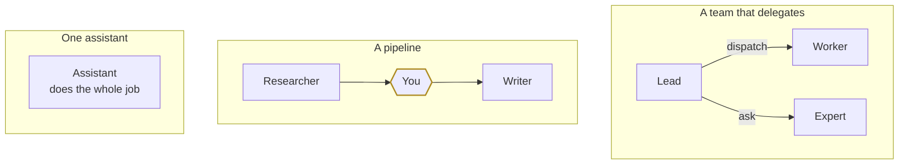

<p align="center">
  <picture>
    <source media="(prefers-color-scheme: dark)" srcset="docs/assets/readme/banner-dark.svg">
    
  </picture>
</p>

<p align="center">
  <a href="https://loomwatch.github.io"><strong>Website</strong></a> &middot;
  <a href="#quickstart"><strong>Quickstart</strong></a> &middot;
  <a href="#how-it-works"><strong>How it works</strong></a> &middot;
  <a href="#features"><strong>Features</strong></a> &middot;
  <a href="#teams-you-can-build"><strong>Recipes</strong></a> &middot;
  <a href="#try-your-first-run"><strong>First run</strong></a> &middot;
  <a href="#faq"><strong>FAQ</strong></a> &middot;
  <a href="#more-guides"><strong>Guides</strong></a>
</p>

<p align="center">
  
  
  
  
</p>

<p align="center">
  
  <br>
  <sub>A team in its chat: ask it, approve the handover with a note, read the answer.</sub>
</p>

**Install on a Mac** (macOS 11 or newer; nothing else to install first): download
**[LoomWatch-macos.dmg](https://github.com/tnghia903/loomwatch/releases/latest/download/LoomWatch-macos.dmg)**,
open it, drag LoomWatch to Applications, and open it. Then follow
[Try your first run](#try-your-first-run).

**Install on Windows** (Windows 10 or 11, 64-bit; nothing else to install first): download
**[LoomWatch-windows-setup.exe](https://github.com/tnghia903/loomwatch/releases/latest/download/LoomWatch-windows-setup.exe)**
and open it. Then follow [Try your first run](#try-your-first-run).

Installed LoomWatch from Terminal before? Read
[Installed from Terminal before?](#installed-from-terminal-before) first.

## Your agents are the threads. LoomWatch is the loom.

LoomWatch runs on your computer and opens in your browser. Build each agent once and try it on its
own, connect your agents into a workflow on a canvas, then give the team work in its chat and watch
their progress, tool calls, handovers and final answer in one place. Run a single agent, a
step-by-step pipeline, or a team that delegates work as it goes. When the team needs you, it stops
and asks.

<p align="center">
  <sub>MODELS FROM EVERY MAJOR AI COMPANY</sub><br>
  <strong>Claude</strong> &nbsp;·&nbsp; <strong>GPT</strong> &nbsp;·&nbsp; <strong>Gemini</strong> &nbsp;·&nbsp;
  <strong>DeepSeek</strong> &nbsp;·&nbsp; <strong>Kimi</strong> &nbsp;·&nbsp; <strong>Qwen</strong><br>
  <sub>on your ChatGPT plan, your Claude plan's API credit or one OpenRouter key, with nothing else to install</sub>
</p>

## How it works

<table>
<tr>
<td width="50%" valign="middle">
<picture>
  <source media="(prefers-color-scheme: dark)" srcset="site/assets/app/agents-dark.webp">
  
</picture>
</td>
<td width="50%" valign="middle">

### 01 &nbsp;Agents

**Build an agent** once: its job, the model it thinks with, its skills, and the keys it may use
without asking, such as the web or running commands. Pick it a face, **try it on its own**
with a real request, and save it to **My agents**. Change its job later and each team keeps the
copy it was given until you choose **Update** in that team.

</td>
</tr>
<tr>
<td valign="middle">

### 02 &nbsp;Workflow

Start a team with the agents you built, and connect who hands work to whom on a canvas.
LoomWatch reads the team back to you in **one plain sentence**, so you can check the plan before
anything runs.

</td>
<td valign="middle">
<picture>
  <source media="(prefers-color-scheme: dark)" srcset="docs/assets/readme/step-build-dark.png">
  
</picture>
</td>
</tr>
<tr>
<td valign="middle">
<picture>
  <source media="(prefers-color-scheme: dark)" srcset="docs/assets/readme/step-watch-dark.png">
  
</picture>
</td>
<td valign="middle">

### 03 &nbsp;Chat: ask, and watch

Each team has one chat. Write **@team** and the job in plain words: _"@team Prepare today's AI and
tech news digest, and link every claim."_ Each stage starts when the one before it hands over, and
what the agents tell each other shows in the chat as they say it. A note you write while an agent
works joins its next turn, each agent's status is said in words beside its face (_"Writing its
reply"_, _"Waiting for you"_), and every handover lands on a **live timeline** in Details that you
can drag back to replay. Paste a screenshot or drop files on the chat to send them with your words;
drop a folder and it becomes a source for the team.

</td>
</tr>
<tr>
<td valign="middle">

### 04 &nbsp;Review

A **You** step pauses the team, and the handover waits in the chat with **Approve** and **Send
back** on it. Approve it, or write what should change and send it back. **Nothing moves on until
you decide**, and the finished answer comes with the evidence to check before you use it.

</td>
<td valign="middle">
<picture>
  <source media="(prefers-color-scheme: dark)" srcset="docs/assets/readme/step-review-dark.png">
  
</picture>
</td>
</tr>
</table>

## LoomWatch is right for you if

- ✅ You want AI agents to **work on one job together**, without installing coding tools or signing
  in to an AI app.
- ✅ You want to **build an agent once, try it on its own**, and reuse it in every team that needs it.
- ✅ You want to **see what each agent did**, not just read a final answer: every tool call, file and
  handover is recorded.
- ✅ You want to **approve or redirect work** before the next agent builds on it.
- ✅ You want it **on your own computer**, with skills you add from skills.sh, ClawHub or GitHub, or
  bring in from the AI apps you already have.
- ✅ You run the same kind of job again and again, such as a daily digest or a research brief, and
  want it **repeatable, or scheduled**.

## What changes when your agents work as a team

| Without LoomWatch | With LoomWatch |
| --- | --- |
| You copy one chat's answer into the next chat's prompt. | Agents hand work to each other, and every handover is on the timeline. |
| You find out what an agent did by scrolling back through its terminal. | Every message, tool call and file it touched is recorded, and you can replay it. |
| A weak first step quietly shapes everything after it. | A review step stops the team until you approve, or send the work back. |
| Each AI app keeps its own skills and folders. | Skills and the folders and files you choose are delivered to the agents that need them. Take one off and it is turned off for that agent. |
| You set the same agent up again in every project. | Build it once in My agents, try it on its own, and add it to any team. Each team keeps its copy until you choose Update. |
| Doing the job again means retyping the prompt. | One chat per team that remembers the conversation, **@** an agent to redo one step, and daily schedules. |

## How a run works


Each agent runs on LoomWatch's own agent, inside the program on your computer. It thinks with the
model you chose, paid through your ChatGPT plan, your Claude API credit or
[OpenRouter](https://openrouter.ai) with your own key, and uses
LoomWatch's tools to read and write files in its folder, search the web and run commands, each only
as far as you allow. Agents can hand work to each other, or ask each other questions, through
LoomWatch's Team Bus. Every message, tool call and
handover is recorded in a local database, so you can watch a run live, replay it later, and follow
up from any step.

### Three ways to run a team



**One assistant** does the whole job. **A pipeline** runs its stages in order, each one receiving
the last one's handover, with review stops wherever you put them. **A team that delegates** starts
with a lead that hands out work and asks its teammates questions as it goes.

## Features

<table>
<tr>
<td width="33%" valign="top">

### 🧑‍🔧 My agents

Build an agent once: its job, model, skills and the keys it may use. Try it on its own in its
**Chat** tab, then add it to any team. Change it later and each team keeps the copy it has until
you choose **Update** there. Tell them about you once, in **About you**, and every agent fits its answers
to you. Your agents line the left of each agent's page, and your teams the left of each team's:
one click moves to another, and each glows while it works or waits for you.

</td>
<td width="33%" valign="top">

### 🧶 A face for every agent

Pick each agent a figure from a sewing-box crew and a colour. It is the same on the canvas, in the
team sentence, in the chat and in Details, and it moves only as the run record says.

</td>
<td width="33%" valign="top">

### 🩺 Make it work better

Each agent's panel suggests what would help, read from the team file and its last five runs, each
with a one-click fix, and says about how many tokens a run uses.

</td>
</tr>
<tr>
<td valign="top">

### 🧵 One team, many models

Each agent thinks with its own model, from your ChatGPT plan, your Claude credit or hundreds on
OpenRouter: Claude researches, GPT checks, a free model drafts. Every run's receipt shows what it
cost and how it was paid.

</td>
<td width="33%" valign="top">

### 🗺️ Connect a workflow

Add agents from **My agents** and a **You** review step where you want to check the work, connect
them in order, and read your team back as one plain sentence before anything runs.

</td>
<td width="33%" valign="top">

### 👀 Watch every step

Live stages, tool calls, each agent's status in words, a team chat of what the agents said to each
other, and a run receipt stamped with how the run ended and the tokens it used. Drag the timeline to
replay what happened, and when.

</td>
</tr>
<tr>
<td valign="top">

### ✋ You stay in the loop

Add a **You** step to approve the work or send it back with changes. A check step can send the work
back to be fixed, up to three rounds, and then ask you. Agents can also stop and ask you a question
mid-run, and when one asks to run a command you can change it first, or answer in its place. In
**Auto** mode, commands that only read or download run without asking.

</td>
<td valign="top">

### 🧾 Evidence you can check

A skill shows as loaded only when it was actually sent, and as opened only when the agent's own
stream read it. Nothing is guessed from a title.

</td>
<td valign="top">

### 🧰 Skills, folders and files

Add skills from skills.sh, ClawHub or GitHub, or copy in the ones your AI apps already have. Give an
agent any folder or file: PDFs, Word, Excel and PowerPoint files, and emails saved from Mail, are
read as text, with nothing to install, and an agent on a model that can see pictures looks at
screenshots and photos. LoomWatch
delivers each one to the agents you choose, and turns off what you take off the canvas.

</td>
</tr>
<tr>
<td valign="top">

### 🧠 Team memory

A **Brief** of shared instructions and files, and a **Notebook** of reusable notes and checkpoints
that carry from one run to the next.

</td>
<td valign="top">

### 💬 One chat per team

Write **@team** to start everyone, **@Writer** to ask one agent, or a note the team reads next time.
A note to an agent at work goes into its next turn, so it revises with everything it already has.
**Reply** under anything an agent said tells it exactly what you mean, and a face you put on its
work is read by the team's next run.

</td>
<td valign="top">

### ⏰ Schedules and Notion

Run a team every morning and send the answer to Notion. A review stop still waits for you. Give an agent a Notion page to read by dragging Notion onto it.

</td>
</tr>
<tr>
<td valign="top">

### 💬 Ask LoomWatch

Describe the team you want in a sentence. Ask sets it up on the canvas, on the models you've
connected, and nothing is saved until you click **Apply**.

</td>
<td valign="top">

### 🎓 Guided first run

Your first agent asks what to make first, and asks which AI should answer only when you send.
**Just look around** skips to Home, where a three-minute guide shows the rest.

</td>
<td valign="top">

### 🔒 Runs on your computer

The app, your teams, your run history and your keys stay on this computer. Agents send their prompts
to the model you chose: at OpenAI, at Anthropic, or through OpenRouter.

</td>
</tr>
</table>

## Teams you can build

Every team below is made of agents you build in **My agents**, each starting from a job such as
Researcher or Writer, on the model its kind of work suits. Start from **New team** with the agents
you built, then add, connect and rename agents to match. To run a team on a schedule, ask
[Ask LoomWatch](#ask-loomwatch-to-set-up-a-team) to add one, or see [Routines](docs/WATCH.md#routines).

| Team | The steps | Good for |
| --- | --- | --- |
| **Morning briefing** | ⏰ Every day at 10:00 → Collector → Editor → Writer → Notion | A digest that is waiting when you start work |
| **Research team** | Lead → Researchers *(at the same time)* → Writer | A report on a big question, with a source cited for every claim |
| **Research and review** | Researcher → Reviewer | Answers whose sources a second agent has checked |
| **Approve before writing** | Researcher → ✋ **You** → Writer | Anything where a wrong first step is costly |
| **Code with a second opinion** | Coder → Reviewer *(another company's model)* → ✋ **You** | Changes in a folder, checked before you keep them |
| **From numbers to slides** | Analyst → Designer | A deck or page built from real data |

## See it

<table>
<tr>
<td align="center">
<picture>
  <source media="(prefers-color-scheme: dark)" srcset="site/assets/app/home-dark.webp">
  
</picture>
<br><sub><strong>Home.</strong> Your agents first, each with its face, then the teams they work in.</sub>
</td>
</tr>
<tr>
<td align="center">
<picture>
  <source media="(prefers-color-scheme: dark)" srcset="site/assets/app/workflow-dark.webp">
  
</picture>
<br><sub><strong>Workflow.</strong> Your agents on the canvas, connected in order and read back as one sentence.</sub>
</td>
</tr>
<tr>
<td align="center">
<picture>
  <source media="(prefers-color-scheme: dark)" srcset="site/assets/app/chat-dark.webp">
  
</picture>
<br><sub><strong>Chat.</strong> What the agents say to each other, your review, and the record one pane away in Details.</sub>
</td>
</tr>
</table>

## What LoomWatch is not

- **Not a chatbot.** It runs teams of agents, each with its own job, and shows you every step.
- **Not a cloud service.** It runs on your computer and keeps your run history there.
- **Not a model provider.** Your agents use models through your own ChatGPT plan, Claude API credit
  or OpenRouter key, and each is paid the way it always is: your plan's limits, your monthly credit,
  or OpenRouter's prices.
- **Not autopilot.** You choose where the team stops for your review, and it waits for you.

## Quickstart

### The Mac app

1. Download **[LoomWatch-macos.dmg](https://github.com/tnghia903/loomwatch/releases/latest/download/LoomWatch-macos.dmg)**
   (about 30 MB, for Apple silicon and Intel Macs) and open it.
2. Drag **LoomWatch** to **Applications**, then open it from Applications.

LoomWatch opens in your browser, where your first agent asks what to make first. It then waits at
the notch at the top middle of each screen: the black notch around the camera on a MacBook with
one, and a small black tab LoomWatch draws there on any other screen. LoomWatch's face sits beside
it.
Point at it to see your teams, and click **⋯** there for **Open LoomWatch**, **Start at login**,
**Show at the notch**, **Show log** and **Quit LoomWatch**. Turn off **Show at the notch** to hide
it: LoomWatch's face moves to the right side of the menu bar. Click the face for the same menu, and
to turn the notch back on. There is no window to keep open; closing the browser tab leaves
LoomWatch running until you quit it. Then follow [Try your first run](#try-your-first-run).

To keep one of your agents at hand, open it in **My agents**, click its name at the top and choose
**Pin to the notch**. Its figure then takes the place of LoomWatch's face. Press **⌃⌥Space**
(Control-Option-Space) in any app, or point at the notch, and write to it. Both need **Show at the
notch** turned on. Drag a file, a picture, an email from Mail, a link or some text to the notch to
hand it over: the notch opens to take it, offers a few jobs that fit, and you can say your own.
iPhone photos go in as JPEGs. A file your agent can't open, such as a Pages document or a video,
stays out, and the notch says what to do instead, such as exporting it as a PDF; drop the PDF and
it joins what is already there. Its answer shows
at the notch: **Copy** it and paste it into any app, and it keeps its headings, lists and links
where that app takes formatting. It can ask one of your teams to do part of the work; that team only
starts when you press **Start**, and that run costs what any run of the team costs.

> [!NOTE]
> LoomWatch is not notarized by Apple yet, so the first time you open it macOS may say it can't
> check it for malicious software. Click **Done**, open **System Settings › Privacy & Security**,
> scroll down, and click **Open Anyway** beside LoomWatch. macOS asks only once.

### The Windows app

1. Download **[LoomWatch-windows-setup.exe](https://github.com/tnghia903/loomwatch/releases/latest/download/LoomWatch-windows-setup.exe)**
   (for 64-bit Windows 10 and 11) and open it.
2. It installs LoomWatch for you alone (no administrator needed), adds it to the Start menu, and
   opens it.

LoomWatch opens in your browser, where your first agent asks what to make first. It keeps an icon
beside the clock (click the **^** there if it is hidden). Click the icon to open LoomWatch; right-click it for
what waits on you, who is working and what finished in the last hour (click one to open it), and
for **Start at sign-in**, **Show log** and **Quit LoomWatch**. There is no window to keep open.
Then follow [Try your first run](#try-your-first-run).

> [!NOTE]
> LoomWatch is not signed with a code-signing certificate yet, so the first time you open the
> installer Windows may say it protected your PC. Click **More info**, then **Run anyway**.

> [!TIP]
> Nothing connected yet? Click **Just look around** to see the app first.

LoomWatch runs on your computer as one program, and keeps your run history in one file there, so
your agents can work in the folders you give them.

### Installed from Terminal before?

LoomWatch no longer comes as a Terminal install. A copy installed that way (version 0.11.0 or
older) gets no more updates: its **Update and restart** and `loomwatch update` stop, saying the
download did not finish. Move to the Mac app or the Windows app. The app uses the same teams
folder, `~/LoomWatch/teams` (`%USERPROFILE%\LoomWatch\teams` on Windows), and the same run
history file, so your teams and history are there when it opens.

1. Stop the Terminal copy, since only one LoomWatch can use the history at a time: press
   <kbd>Ctrl</kbd>+<kbd>C</kbd> in its window, or run `~/LoomWatch/app/loomwatch stop`
   (`loomwatch stop` on Windows).
2. Delete only its `app` folder, and keep `teams` beside it, which holds your teams:
   `rm -rf ~/LoomWatch/app`, and `rm ~/.local/bin/loomwatch` if that shortcut exists. On Windows,
   delete `%USERPROFILE%\LoomWatch\app`. You can also remove it from your `PATH` (Start menu,
   "Edit environment variables for your account"); leaving it does no harm.
3. Install the app, as above, and open it.

Installed it in another folder? Its run history is in `.loomwatch/loomwatch.db` inside that folder.
With LoomWatch stopped, move that file to `~/Library/Application Support/LoomWatch/`
(`%LOCALAPPDATA%\LoomWatch` on Windows) before you delete the folder.

A run history that a version before 0.5 kept in Docker stays in Docker Desktop, as the
`loomwatch-app_postgres-data` volume, and the app doesn't read it; delete it there once you no
longer need it.

### What you need

- **A Mac** with macOS 11 or newer, or **a Windows PC** with 64-bit Windows 10 or 11.
- **For real runs, one way to pay for models.** Connect any of these on Home, or on
  **Connections…** in the ☰ menu. Each model you pick says which one pays for it.
  - **Your ChatGPT Plus or Pro plan.** Click **Continue with ChatGPT** and allow LoomWatch on
    ChatGPT's own page. Agents on ChatGPT models count against your plan's limits, at no extra
    charge. LoomWatch never sees your password.
  - **Your Claude Max or Team plan's API credit.** These plans include API credit every month:
    $100 on Max 5x, $200 on Max 20x, and up to $500 on Team. On claude.ai, open
    **Settings › Billing** and link a Claude Console organization under API credits. Make an API key
    in that organization and paste it into **Your Claude API credit**. Claude Pro and Free plans
    have no API credit.
  - **An [OpenRouter](https://openrouter.ai) API key.** One key reaches models from Anthropic,
    OpenAI, Google and others, including some free ones, and you pay per use. Make one at
    [openrouter.ai/keys](https://openrouter.ai/keys), add a few dollars of credit for the models
    that aren't free, and paste it into **OpenRouter (pay per use)**.

  LoomWatch checks each with its company, then keeps it in this Mac's Keychain, or on Windows in
  Windows Credential Manager. You need one only when you send your first request.

LoomWatch never borrows another AI app's sign-in, such as Claude Code's, Codex's or Gemini's.
Anthropic doesn't allow a Claude sign-in in other apps, which is why a Claude plan connects through
its API credit. Nothing else needs installing.

> [!WARNING]
> On Windows, commands an agent runs are not sandboxed: an agent you let run commands can change
> any of your files. See [SECURITY.md](SECURITY.md).

### What the first start does

1. Creates your teams folder, `~/LoomWatch/teams` (`%USERPROFILE%\LoomWatch\teams` on Windows), if
   the folder does not exist yet. It starts empty: the first run is where you make your first agent.
2. Starts LoomWatch and opens **<http://127.0.0.1:3000>** in your browser, or the next free port
   when another program uses 3000.
3. Keeps your run history, notes and checkpoints in one file,
   `~/Library/Application Support/LoomWatch/loomwatch.db` (`%LOCALAPPDATA%\LoomWatch` on Windows),
   so they survive restarts and reinstalling.

The app needs no window: quit it from its menu (on a Mac, point at the notch at the top of the
screen and click ⋯, or click LoomWatch's face in the menu bar; on Windows, right-click its icon
beside the clock). The Mac app's log is in `~/Library/Logs/LoomWatch`, and the Windows app's in
`%LOCALAPPDATA%\LoomWatch\Logs`; **Show log** in the menu opens it.

LoomWatch reads no other app's settings or sign-ins. Your skills live in LoomWatch's own folder (see
[Where your work is saved](#where-your-work-is-saved)). On the **Skills** page (top of Home), **Look on this computer**
copies in the skills your AI apps keep, and only when you click it.

### Every day

| To | Do this |
| --- | --- |
| Start LoomWatch, or open it if it is already running | Open LoomWatch from Applications, or on Windows from the Start menu. While it runs, **Open LoomWatch** in its menu does the same (on Windows, click its icon beside the clock) |
| Stop LoomWatch | **Quit LoomWatch** in the app's menu (⋯ at the notch, or LoomWatch's face in the menu bar; on Windows, right-click its icon beside the clock) |
| Start LoomWatch when you sign in to the computer | **Start at login** in the app's menu (**Start at sign-in** on Windows) |
| Update to the newest release | **Update available** on Home, then **Update and restart** |
| See which version you have, and whether a newer one is out | <kbd>⌘</kbd><kbd>K</kbd> (<kbd>Ctrl</kbd>+<kbd>K</kbd> on Windows) → **Check for updates…** |

Quitting keeps your teams and history. Running a copy of the source instead? Its commands are in
[Build from source](#build-from-source).

### Updating

Each time you open LoomWatch, it checks whether a newer release is out. When one is, Home shows
**Update available**. Click it to read what changed; <kbd>⌘</kbd><kbd>K</kbd>
(<kbd>Ctrl</kbd>+<kbd>K</kbd> on Windows) → **Check for updates…** opens the same window at any
time. Nothing is installed until you ask for it.

Click **Update and restart**. LoomWatch asks first, naming any team still working, since updating
stops it. Then it saves a copy of your run history in `~/LoomWatch/backups/desktop-app`, downloads
the new version, checks the download is complete, puts it in place of the one you have, and opens
it again; the page says when the new version is running. Your teams and history stay. If any step fails, the
version you had opens again and the page says why. The Mac app keeps the version it replaced beside
it, hidden, as `.LoomWatch.app.previous`.

The Mac app can't replace itself while it runs from the disk image or from Downloads, or from a
folder your account can't change; the window then says so and shows the steps to do it by hand:
download the new
[LoomWatch-macos.dmg](https://github.com/tnghia903/loomwatch/releases/latest/download/LoomWatch-macos.dmg),
quit LoomWatch from its menu (point at the notch at the top of the screen and click ⋯, or click
LoomWatch's face in the menu bar), drag
the new one to Applications and choose **Replace**. On
Windows, the steps are to download the new
[LoomWatch-windows-setup.exe](https://github.com/tnghia903/loomwatch/releases/latest/download/LoomWatch-windows-setup.exe)
and open it; it closes LoomWatch, puts the new version in its place, and opens it again. Versions
0.6.3 and older of the apps don't have **Update and restart**: update those once by hand.

The check asks GitHub for the newest version number and sends nothing about you, your teams or
your runs. Turn it off in the **Check for updates** window. A copy of the source is updated in its
terminal instead: see [Build from source](#build-from-source).

To stop one run, click **Stop** beside the request box. Closing the browser tab does not stop LoomWatch or
its runs. Scheduled teams run only while LoomWatch is running and the computer is awake. If a scheduled run can't
reach its AI, often just after the computer wakes, LoomWatch tries it again by itself, up to five more times within the
hour. Each try starts the work over, and costs what it uses. For scheduled runs and optional Notion delivery, see [Routines](docs/WATCH.md#routines) and
[Notion setup](docs/NOTION.md).

### Remove LoomWatch

1. Disconnect what you connected: choose **Connections…** from the ☰ menu, click **Remove key** on
   **Your Claude API credit** and **OpenRouter (pay per use)**, and **Sign out** on
   **Your ChatGPT plan**. Otherwise the OpenRouter key stays in your Keychain as
   `LoomWatch.OpenRouter`, and the Claude key and ChatGPT sign-in as `LoomWatch.Plans` (on Windows,
   in Windows Credential Manager under LoomWatch's name, where a Notion sign-in is kept too). To
   stop the keys working anywhere, delete them at [openrouter.ai/keys](https://openrouter.ai/keys)
   and in the Claude Console too.
2. Remove the app. **The Mac app:** in its menu (point at the notch at the top of the screen and
   click ⋯, or click LoomWatch's face in the menu bar), turn off **Start at login**, choose **Quit LoomWatch**, and drag LoomWatch from
   Applications to the Trash. After an update, the version it replaced is beside it, hidden, as
   `.LoomWatch.app.previous`: press <kbd>⌘</kbd><kbd>⇧</kbd><kbd>.</kbd> in Applications to show
   it, and drag it to the Trash too. **The Windows app:** remove LoomWatch in **Settings › Apps ›
   Installed apps** (it quits LoomWatch first and turns off Start at sign-in).
3. Your teams are kept in `~/LoomWatch/teams` (`%USERPROFILE%\LoomWatch\teams` on Windows) until
   you delete `~/LoomWatch` (`%USERPROFILE%\LoomWatch`) too. It also holds Your agents, deleted teams, the agents' working
   folders, and in `backups` the copies of your run history that updates saved.
4. Your run history, Notebook entries and Ask conversations, your skills, which teams you approved
   to run, and your update-check choices are in `~/Library/Application Support/LoomWatch`
   (`%LOCALAPPDATA%\LoomWatch` on Windows, with the log). Delete that folder too, and on a Mac the
   log in `~/Library/Logs/LoomWatch`, to leave nothing behind.

To open a folder such as `~/Library/Application Support/LoomWatch`, choose **Go › Go to Folder…**
in Finder and paste it (`~` is your home folder). On Windows, paste `%LOCALAPPDATA%\LoomWatch` into
File Explorer's address bar.

For a copy built from source, run `./loomwatch stop` in its folder, then delete the folder: its run
history is inside it, in `.loomwatch/`.

### Build from source

To change LoomWatch, or to run the newest code on `main`, build it yourself. That needs Git,
[Node.js](https://nodejs.org/) 22.12 or newer and [Rust](https://rustup.rs/); the exact Rust
version downloads on its own during the first build. With Homebrew:

```sh
brew install node
curl --proto '=https' --tlsv1.2 -sSf https://sh.rustup.rs | sh -s -- -y
```

Open a new terminal window so it finds the new tools, then:

```sh
git clone https://github.com/tnghia903/loomwatch.git
cd loomwatch
./loomwatch
```

On Windows, install Git, Node.js and Rust (`winget install Git.Git OpenJS.NodeJS.LTS
Rustlang.Rustup`, and let Rust's installer add the Visual Studio C++ build tools it asks for), then
run `.\loomwatch.cmd` in the cloned folder wherever this guide says `./loomwatch`.

The first start builds the browser app and the program, which takes a few minutes, then starts
LoomWatch and opens it in your browser. Keep that terminal window open while you use LoomWatch.
`main` moves faster than the releases, so expect rough edges. A copy of the source keeps its own
run history in `.loomwatch/loomwatch.db` inside its folder, apart from the app's. A history it kept
in Docker before 0.5 is copied in only by 0.5.0: run `git checkout v0.5.0 && ./loomwatch` once
first.

| To | Run |
| --- | --- |
| Start LoomWatch, or open it if it is already running | `./loomwatch` |
| Stop LoomWatch | Press <kbd>Ctrl</kbd>+<kbd>C</kbd> in its window, or run `./loomwatch stop` |
| Update to the newest `main` | `./loomwatch update`: it pulls the newest `main` and, when anything changed, saves a copy of the run history before it rebuilds and starts LoomWatch |
| See which version you have, and whether a newer release is out | `./loomwatch version` |
| See every option | `./loomwatch help` |

To go back, run the `git checkout` command that `update` prints. In a copy of the source, the updates window shows the `update` command to run
instead of **Update and restart**.

<details>
<summary>What <code>./loomwatch</code> runs, if you prefer to do it by hand</summary>

```sh
(cd ui && npx --yes pnpm@12 install --frozen-lockfile && npx --yes pnpm@12 run build)
cargo build --release --locked --bin loomwatchd
mkdir -p "$HOME/LoomWatch/teams"
./target/release/loomwatchd serve --teams-root "$HOME/LoomWatch/teams" --listen 127.0.0.1:3000 \
  --database .loomwatch/loomwatch.db
```

The browser app is built before the program because it is packed into it. `loomwatchd backup <file>`
saves a copy of the run history, safely while it runs.

</details>

### Change the defaults

These settings are for a copy of the source, started with `./loomwatch`. The apps use the
defaults, and move to the next free port by themselves when another program uses 3000.

| Setting | Default | For example |
| --- | --- | --- |
| Browser port | `3000` (or `LOOMWATCH_PORT` in `.env`) | `LOOMWATCH_PORT=3001 ./loomwatch` |
| Teams folder | `~/LoomWatch/teams` | `LOOMWATCH_TEAMS_ROOT=~/Work/teams ./loomwatch` |
| Run history file | `.loomwatch/loomwatch.db` in the copy's folder | `LOOMWATCH_DATABASE=~/Work/loomwatch.db ./loomwatch` |
| Copies of the run history saved by `update` | `~/LoomWatch/backups` | `LOOMWATCH_BACKUP_DIR=~/Backups/LoomWatch ./loomwatch update` |
| Check for a newer version each time LoomWatch opens | On | `LOOMWATCH_UPDATE_CHECK=off ./loomwatch`, or turn it off in **Check for updates** (in the apps too) |

`./loomwatch --no-open` starts without opening the browser, `--no-backup` updates without saving a
copy of the run history first, `--yes` answers yes to its questions, such as stopping LoomWatch to
update it, and `--rebuild` builds again even when nothing changed. `./loomwatch help` lists
everything. In PowerShell, set a setting for one start like this:
`$env:LOOMWATCH_PORT=3001; .\loomwatch.cmd`.

## Try your first run

The first time you open LoomWatch, your first agent asks **What shall we make first?** Write
anything, or pick one of the examples, and send it. If no AI is connected yet, it asks which one
should answer: your ChatGPT plan, your Claude API credit or an OpenRouter key, each with what it
costs. After its first answer it offers **Tell my agents about me**: your name, what you do, and the
language and length you want. Then it answers again, made for you. **Keep this agent** adds it to My
agents, and **Go to Home** leaves it there. **Just look around**, at the top, goes to Home at any
time.

For a tour of the rest, click **New here? Take the 3-minute guide** on Home, or choose **Getting
started guide** from the ☰ menu or <kbd>⌘</kbd><kbd>K</kbd>. It walks you through building
an agent, trying it on its own, putting it in a team and running it.

<details>
<summary>Try a team without a model</summary>

A new install has no teams. Download the offline demo team,
[examples/operator-stop.yaml](examples/operator-stop.yaml), into your teams folder
(`~/LoomWatch/teams`), open LoomWatch and pick **Review stop demo** under **Your teams**. It is a
three-step workflow: **Researcher → You → Writer**. Its agents produce fixed responses so you can
learn the interface without calling a model provider.

1. Open the team's **Chat** tab (or click **Run team** in **Workflow**), type
   `@team Prepare a short getting-started guide for new users.` in the message box at the bottom,
   and press <kbd>Enter</kbd> (<kbd>Shift</kbd>+<kbd>Enter</kbd> adds a new line). Only a message
   with an **@** starts work; the box says where each message goes before you send it.
2. When the team pauses for you, the chat shows what Researcher handed over, with **Approve** and
   **Send back to Researcher** under it.
3. To ask for changes, type `Use the short guide and remove the detailed walkthrough.` in the box
   and click **Send back to Researcher**. The researcher revises its work and asks again.
4. Click **Approve** to let the team continue. To pass on a note, type it first; the button then
   says **Approve with your note**, and your note goes on as your direction.
5. Read the team's answer in the chat. The demo writer echoes the direction it received.

</details>

Everything the team has done stays in its chat: scroll up, or search it with the magnifier at the
top. **Details** on any piece opens its stages, timeline and record beside the chat; drag across
the timeline to replay what happened. To change one step's work, write **@** and that agent's name
with what should change; under its new version, **Continue with the team** runs the steps after it.

## Run your own agents

1. Connect a way to pay for models, on Home or on **Connections…** (☰ menu): click
   **Continue with ChatGPT**, or paste a Claude API key or an OpenRouter key. LoomWatch checks each
   with its company. **Usage…** in the ☰ menu shows what LoomWatch has used on each.
2. Click **Build an agent** on Home and start from a job, such as Researcher or Writer, or from
   **Blank**. Give it a name, change its instructions, model and how hard it thinks to fit your work,
   pin up the skills it needs and hand it the keys it may use without asking. Pick it a face, then
   open its **Chat** tab and give it a real request: it runs on its model, and asks you before it
   uses a key it wasn't given. **Save to My agents** when it does the job.
3. Click **New team**, give it a name and choose the agents it starts with. A team always starts
   with at least one:
   - **My agents** — tick the agents you built; each joins as you last saved it (recommended once
     you have one).
   - **One assistant** — a single agent that does the whole task (recommended to begin with).
   - **Researcher and writer** — one agent gathers facts, a second writes the result.
   - **Research, write and check** — a third agent, on another company's model, checks the finished
     piece against what it must have.
   - **Research, your approval, then writing** — the team pauses so you can approve the research.
   - **Research team** — a lead splits your question, researchers look into each part at the same
     time, and a writer turns what they found into a report that cites every source.

   Ready-made teams are saved straight away, each agent on the model its job suits, so you can run
   them immediately.
4. A team has three tabs: **Agents**, **Workflow** and **Chat**. On **Agents**, click **Add an
   agent** to bring in one from My agents. On **Workflow**, add more from **My agents** in the
   panel on the left; to make a new one, choose **Build a new agent** and start from a job such as
   Researcher or Writer. Select a card to edit its name, instructions, model and how hard it
   thinks. Drag from the dot on a card's right edge to the next card to make them work in order, and
   add **You (review step)** wherever you want to approve work before the team continues.
5. Click **Run team**, or open **Chat**, describe what you want in plain words, and press
   <kbd>Enter</kbd>.

In the chat, **Reply** under anything an agent said, such as a handover, a question or the answer:
the agent is told which message you mean, and a reply to an agent at work joins its next turn. Put
a face on what an agent said, such as **Good**, **Not sure** or **Wrong**, and the team's next run
reads what it meant. Tell your agents about you once, with **About you…** in the ☰ menu: every agent
reads your name and what you wrote before it works, including the language, length and tone you ask
for.

Each agent's model says how it is paid: `chatgpt:gpt-6.1-sol` on your ChatGPT plan,
`anthropic:claude-opus-5-5` on your Claude API credit, or an OpenRouter model id such as
`anthropic/claude-opus-5.5`. The model picker keeps the three apart, each headed by what it costs,
suggests a model for the agent, and searches every model you can use. The suggestion picks the
model first, for the kind of work: Claude Opus 5.5 for most agents, and for a check step a model
from another company, so the work is read by a model that didn't write it. Then it runs on a plan
you've connected that offers that model, or else through OpenRouter.

> [!IMPORTANT]
> Real runs are paid the way each agent's model is: from your ChatGPT plan's limits, from your
> Claude credit, or by OpenRouter at each model's price. Each run's receipt shows what it cost. Your
> request, the agents' instructions and the files and pages they read go to the company whose model
> you chose, through OpenRouter when that is how it's paid. Running LoomWatch locally does not make cloud models
> offline. Free models change often, and some let their maker learn from what you send, so keep
> private work for a model you pay for.

<details>
<summary><strong>Keep the pipeline easy to follow</strong></summary>

Choose **Organize** from the ☰ menu at the top right (or press <kbd>⌥</kbd><kbd>⌘</kbd><kbd>L</kbd>,
or choose **Organize pipeline** in <kbd>⌘</kbd><kbd>K</kbd>) to arrange stages from left to right
and group skills and sources below their agents. The view then fits the arranged team. **Undo
organize**, in the same menu, restores the previous arrangement. Positions are saved with the canvas
layout; organizing does not change the workflow or start a run.

</details>

<details>
<summary><strong>Connect skills, knowledge and tools</strong></summary>

The add panel on the left of **Workflow** lists your skills and the teams whose memory you can
share. **Manage skills** opens the Skills page, where you add more: search skills.sh and ClawHub at
once, paste a GitHub link, or copy in the skills your AI apps already have. Each one shows its
license and what it needs before anything is copied, and nothing in it runs when it is added. Add a
skill to the canvas, then drag from an agent to it, or
open the card's **Details & connections** and tick the agents that should use it. To give an agent
a folder or a file, select the agent and click **Folder** or **File** under **Given** in its
**Context**. Save the team, and the next run delivers it:

- A **skill** is copied into the agent's working folder, and the agent is told to read it in full
  before it starts. Every agent also sees the name and purpose of each skill in LoomWatch, and reads
  one when its work calls for it.
- A **folder or file** is given to the agent as reference material: a folder's listing and README,
  or a file's text, read from a PDF, Word, Excel or PowerPoint file or an email too. A scanned PDF
  has no text to read. The agent can also read the folder or file itself. An added file can be up to 25 MB; link a
  folder for anything bigger.
- A **tool** you connected, such as Todoist or Kiwi.com, lets the agent use that service. Connect one
  in the agent's **Tools it can use** block or in Connections; the agent asks you before each action
  it takes there, unless you always allow that action. See [Give agents tools](docs/TOOLS.md). A tool from an AI app's own settings is
  not given to LoomWatch's agents: an agent that still names one is told it isn't there, and the run
  carries on without it.

Taking a skill card off the canvas, or the line from it to one agent, **turns it off** for that
agent. The agent's **Context** lists what is turned off, with a button to turn each back on. When an
agent's instructions still name what you removed, LoomWatch marks it, and **Rewrite with** Ask's
model drops or rewrites just those sentences as one edit you can keep or put back.

If something cannot be delivered (for example, a skill that is no longer in LoomWatch's skills),
the run stops before it starts and says what to change. If an older team shows "drawn but not
delivered to agents yet" at the top of Workflow, click **Deliver on the next run**, then save.

</details>

<details>
<summary><strong>Give the team context and review its work</strong></summary>

Choose **Team memory** from the ☰ menu to add shared instructions or reference files to the
**Brief**. Use the **Notebook** to review reusable notes and checkpoints.

Select an agent in Workflow to see its **Context**: its place in the team (for example "Step 2 of 3 ·
after Researcher · hands its work to Writer"), the team Brief, and every skill, folder, file and
tool connected to it, each with an × to disconnect it. In a team of two or more, each agent is told
its place at the start of every run. In a run's **Details**, an agent's **What it received** link
shows what it was supplied when its session started.

For a review checkpoint in a pipeline, add a **You** step between two agents and say what to look
at in its **What to check** box. **Approve** passes the work on (it says **Continue** once you
type a note, and your note goes with it). **Send back to** the agent asks for a revision while its
session is still open. An agent can also ask you a question mid-run: type your answer in the
request box and click **Reply**.

</details>

## Ask LoomWatch to set up a team

Click **Ask** at the top of any screen (or press <kbd>⌘</kbd><kbd>J</kbd>), or type in **Or describe
the job** on Home. Say what you want in plain words, such as _"Every weekday at 8, brief me on AI
news"_. Ask sets the team up on the canvas. New and changed agents are marked,
and nothing is saved until you click **Apply**; **Discard** drops the proposal, and **Undo** takes
an applied one back.

- **It asks before it runs.** When it wants to start a run, it waits for you to click **Start run**,
  unless you turn off **Ask me before starting a run**.
- **It never answers a review step.** It can put a drafted note in the review box; only you click
  **Approve** or **Send back**.
- **You choose the model.** Ask runs on LoomWatch's own agent, on a model you've connected, and the
  panel names its model and how it is paid. Click the name to pick another. Each conversation is
  paid like a run. With nothing connected, the panel offers the three ways to connect.

## FAQ

<details>
<summary><strong>Do I need an account or an API key?</strong></summary>

For real runs you need one way to pay for models: your ChatGPT Plus or Pro plan, your Claude Max or
Team plan's monthly API credit, or an OpenRouter API key from
[openrouter.ai/keys](https://openrouter.ai/keys). LoomWatch itself is free and has no account. It
never reads another app's sign-ins: every model call goes through LoomWatch's own agent. Your keys
and your ChatGPT sign-in stay in this Mac's Keychain (on Windows, in Windows Credential Manager; on
Linux, in a file only your user can read), and agents never see them: they are not in their
commands, their folders, the team file or the run history.

Some models on OpenRouter are free. Free models change often, and some let their maker learn from what you send, so keep private work for a model you pay
for.

</details>

<details>
<summary><strong>Can I use my ChatGPT or Claude subscription?</strong></summary>

Yes, two of them.

- **ChatGPT Plus or Pro.** Click **Continue with ChatGPT** and allow LoomWatch on ChatGPT's own
  page. OpenAI lets open-source apps that run on your computer use your plan this way. Agents on
  ChatGPT models count against your plan's limits, at no extra charge. Only Plus and Pro plans can
  be shared with apps. You can see LoomWatch's share, and limit it, under **Manage usage** in
  ChatGPT's settings.
- **Claude Max or Team.** These plans include API credit every month. LoomWatch spends it through
  an API key from the Claude Console organization linked to your plan. A Claude sign-in can't be
  used: Anthropic doesn't allow it in other apps. Claude Pro has no API credit, so it can't be used
  either.

When the model LoomWatch suggests for an agent is one your plan offers, it runs on your plan.
Otherwise it runs through OpenRouter if you've added a key. With neither, it uses your plan's own
model for that kind of work.

</details>

<details>
<summary><strong>What does a run cost?</strong></summary>

It depends on how each agent's model is paid:

- **On your ChatGPT plan,** nothing extra: it counts against your plan's limits, and the receipt
  says "ChatGPT plan".
- **On your Claude API credit,** each call is paid from the credit at Claude's list prices.
  Anthropic doesn't report what a call cost, so LoomWatch works it out and the receipt shows it with
  "≈".
- **Through OpenRouter,** OpenRouter bills your key for each call at that model's price, and the
  receipt shows the exact cost it reported.

**Usage…** in the ☰ menu shows what LoomWatch used on each over the last 30 days, with a link to
where you see the exact figure.

</details>

<details>
<summary><strong>Is my work sent anywhere?</strong></summary>

LoomWatch serves everything on `127.0.0.1` and keeps your run history in a file on this computer.
What an agent works with (its instructions, your request, and the files and pages it reads) goes to
the company whose model it uses, as with any AI service: OpenAI on your ChatGPT plan, Anthropic on
your Claude credit, and through OpenRouter when that is how it's paid. Skills are fetched from
skills.sh, ClawHub or GitHub only when you add one.

</details>

<details>
<summary><strong>Can different agents in one team use different models?</strong></summary>

Yes. Each agent card has its own model and effort, and says how its model is paid. A team can
research on Claude Sonnet from your Claude credit, check on GPT on your ChatGPT plan and draft on a
free model such as DeepSeek or Qwen through OpenRouter.

</details>

<details>
<summary><strong>What happens when an agent asks for permission to do something?</strong></summary>

LoomWatch decides, for every agent. Each agent's panel in **Workflow** has three switches under **Allowed
without asking**: **Search the web**, **Edit files** (only in the agent's own folder) and **Run
commands**. They start off, except **Search the web** for researchers. LoomWatch always allows the
team's own handovers and the tools, folders and files you connected to the agent.

Anything else waits for you. The agent pauses and asks in the team chat, as its own message, such
as "Asks to use the web · Web search · …". You answer right below it: **Allow**, **Allow for this
run**, **Allow for the whole team** (every agent in this run may use that tool without asking),
**Always allow** (which switches it on for that agent) or **Deny**. For a command, **Edit, then
allow** lets you change it before it runs, this once, and **Answer instead** sends the agent your
reply in place of what it asked to do, so nothing runs. The chat keeps how it ended, such
as "You allowed it, this once". The same question shows up in the Needs-you tray from
any screen. If nobody answers within 10 minutes it is declined, and scheduled runs decline it
straight away because nobody is watching.

To ask less often, set `permissions: {mode: auto}` in the team file. A command an agent isn't allowed
to run on its own then runs without asking when every part of it only reads inside the agent's
folder, its knowledge or the temp folder, or is a plain download for an agent allowed the web.
Anything that deletes, pushes, publishes, deploys, needs admin rights, touches credentials or runs a
script given as text always asks, and so does everything else, with the reason on the card.
LoomWatch decides this on your computer from the command itself; no model is asked and nothing is
sent anywhere.

The run records every request and who answered it. When something was declined, the run receipt says
what the agent couldn't do and offers **Allow from now on**.

LoomWatch's agents have no tools that publish, post or message outside the run: they read and write
files in their folder, search and read the web, run commands, and talk to their team. An agent you
allow to run commands or use the web can still reach the internet. Your team's answer leaves
through your review and the delivery you set up, such as **Send every answer to Notion**.

</details>

<details>
<summary><strong>Is it safe to run a team someone shared?</strong></summary>

A team file says what each agent is told, which model it runs on, what it may do without asking,
which folders it works in and when it runs, so treat one from someone else with care. LoomWatch
helps you check it. The first time you run a team that wasn't built in LoomWatch, or that changed
outside it, LoomWatch shows what it will do before anything starts:

- which model each agent runs on;
- what each agent may do without asking;
- the folders it can read;
- whether it runs on a schedule.

Choose **Trust and run** only if you trust where it came from. Until then its schedule does
nothing. A team file can't start a program of its own: a program an older team file names is never
run. See [SECURITY.md](SECURITY.md) for what LoomWatch does and doesn't
protect against.

</details>

<details>
<summary><strong>Can I run it on a server, or entirely in Docker?</strong></summary>

Yes. See [Run everything with Docker Compose](#optional-run-everything-with-docker-compose). The
recommended desktop setup runs LoomWatch itself on your computer, so agents can work in your own
folders.

</details>

## Optional: run everything with Docker Compose

Use this mode for CI, demos, or an intentionally isolated Linux deployment. It is not the
recommended desktop setup: agents in the container can only work in the folders mounted into it.

<details>
<summary>Set up the Compose stack</summary>

To change a default, copy the settings file with `cp .env.example .env` and edit it. Then create a
repository-local teams folder, and build and start the stack:

```sh
mkdir -p teams
cp -n examples/operator-stop.yaml teams/
docker compose up --build --detach --wait
```

Open the [offline review-stop demo](http://127.0.0.1:3000/?path=operator-stop.yaml). The UI is
embedded in the `loomwatch` image, the run history, context packets, Notebook entries and
checkpoints are one SQLite file in the `loomwatch-home` volume, and the app is published only on
host loopback. To stop, finish or stop active runs, then run `docker compose stop`: it preserves
the volume, and `docker compose up --detach --wait` resumes the stack.

The defaults mount these explicit roots:

| Container path | Default host path | Access | Purpose |
| --- | --- | --- | --- |
| `/data/teams` | `./teams` | Read/write | Team YAML, Brief files, layouts, and managed `.loomwatch` workspaces |
| `/workspaces` | `./container/workspaces` | Read/write | Repositories used by container-native agents |
| `/home/node` | `loomwatch-home` volume | Read/write | The run history, your keys and ChatGPT sign-in, and LoomWatch's skills |

</details>

<details>
<summary>Your key and skills in the container</summary>

Connect your models in the browser as on a Mac. In the container the OpenRouter key is kept in
`keys.json`, and the Claude key and ChatGPT sign-in in `plans.json`, in LoomWatch's state folder
inside the `loomwatch-home` volume, readable only by LoomWatch's user, and
the skills you add on the Skills page are kept in the same volume. The image includes Node.js,
Python, Git and curl, for skills whose scripts need them.

Team files running against a mounted repository should use a path below `/workspaces`. Absolute
host paths such as `/Users/name/project` do not exist inside the Linux container.

</details>

## Where your work is saved

| Data | Location in this guide |
| --- | --- |
| Team definitions and canvas layouts | `~/LoomWatch/teams`; Compose-only deployments use `LOOMWATCH_TEAMS_DIR` |
| Brief files | Paths configured by the team, usually beside its YAML file |
| Deleted teams | `.trash` inside your teams folder, one folder per deleted team |
| My agents | `.jobs` inside your teams folder, one `<agent>.yaml` per agent. Earlier versions are in `.jobs/.versions/<agent>/`, removed agents move to `.jobs/.removed`, and the one-agent teams that an agent's **Chat** runs are in `.jobs/.bench` |
| Files you add to an agent (**File** under **Given**) | `<team>.files/` beside the team file |
| Agents' working folders, and Ask's | `.loomwatch/` inside your teams folder |
| Your keys and ChatGPT sign-in | This Mac's Keychain: the OpenRouter key as `LoomWatch.OpenRouter`, the Claude key and ChatGPT sign-in together as `LoomWatch.Plans`. On Windows, Windows Credential Manager, as `api-key.LoomWatch.OpenRouter` and `plans.LoomWatch.Plans`. On Linux and in Compose, `keys.json` and `plans.json` in LoomWatch's state folder, readable only by your user |
| Your skills | `skills/` in `~/Library/Application Support/LoomWatch` (`%LOCALAPPDATA%\LoomWatch` on Windows, `~/.local/state/loomwatch` on Linux from source), and where each one came from in `skills.json` beside it. Skills that travel with a team are in `.agents/skills` beside its file |
| Team chats (your messages and every run), recorded events, Notebook entries and Ask conversations | One file, `loomwatch.db`, in `~/Library/Application Support/LoomWatch` on macOS, `%LOCALAPPDATA%\LoomWatch` on Windows or `~/.local/state/loomwatch` on Linux from source. A copy of the source keeps its own in `.loomwatch/` in its folder; Compose deployments in the `loomwatch-home` volume. |
| Which team files you approved to run, and your update-check choices | `~/Library/Application Support/LoomWatch` on macOS, `%LOCALAPPDATA%\LoomWatch` on Windows, `~/.local/state/loomwatch` on Linux from source |
| Copies of the run history saved by **Update and restart** in the Mac and Windows apps, and by `./loomwatch update` | `~/LoomWatch/backups`: `desktop-app` for the apps, and one folder for each copy of the source, the three newest in each |
| The version the last update replaced, in the Mac app | Beside the app, hidden, as `.LoomWatch.app.previous`: rename it back to `LoomWatch.app` to go back |

Back up your teams folder and the run history if you want to move or preserve your work: quit
LoomWatch and copy `loomwatch.db` and your teams folder. To copy the history while it runs, use
Terminal: `/Applications/LoomWatch.app/Contents/MacOS/loomwatchd backup ~/loomwatch-copy.db` (on
Windows, the program is `%LOCALAPPDATA%\Programs\LoomWatch\bin\loomwatchd.exe`).

> [!WARNING]
> In Compose mode, avoid `docker compose down -v` for normal shutdown: it deletes the
> `loomwatch-home` volume, including the run history and Notebook entries.

<details>
<summary>Deleting and restoring a team</summary>

To delete a team, choose **Delete team…** from its **…** menu on Home, or click the team's name at
the top of its page.
LoomWatch refuses while the team is running, or while another team reads its memory. Nothing is
erased. The team file, its layout, its own notes folder (`<team>.brief`) and the folder of files
added to its agents with **Add file…** (`<team>.files`) move to `.trash/<date>-<team>/` inside your
teams folder; `moved` in that folder's `deleted.json` lists which of them the team had. Its run
history and Notebook entries stay in the run history, and no new team takes its file name while it is
in the trash. To restore it, move everything in that folder except `deleted.json` back to the
folder where `path` in `deleted.json` says the team file was. `<team>.files` must go back too, or
its agents lose the files added to them. In Finder, press <kbd>⌘</kbd><kbd>⇧</kbd><kbd>.</kbd> to show hidden folders. To remove a team for good,
delete its folder from `.trash`.

</details>

<details>
<summary>Reusing an agent with My agents</summary>

Build an agent in **My agents** (**Build an agent** on Home). It appears under **My agents** in
every team's add panel, with its instructions, model, skills and what it may do without asking.

Placing it copies the agent into the team, so a team runs exactly what it was approved with.
Saving a change to what a team copies, such as its job, leaves the teams' copies as they are; a
new face changes nothing in them. The agent's panel in a team says **Changed in My agents** when
there is something new, and offers **Update**, **Edit in My agents**, or **Make it this team's
own** to change it there alone. The builder lists the teams that use the agent and which of them
have an update ready. LoomWatch keeps earlier copies on disk so it can tell which teams have an
update ready; it shows no version numbers.
Removing an agent from My agents leaves the teams' copies alone. An agent is one small file, so
you can share it by copying it into another teams folder's `.jobs`.

An agent made inside a team, such as one from a ready-made team, is listed under **My agents** too,
with its team's name. In the add panel, one of this team's own finds its card on the canvas, and
another team's is added as a copy this team owns. Its knowledge and work folder stay with the team
it came from.

</details>

## Troubleshooting

<details>
<summary>Something did not work? Find what you see in this table.</summary>

| What you see | What to check |
| --- | --- |
| The app's menu says LoomWatch is already running from Terminal, or was started elsewhere | A LoomWatch started from Terminal is still running, such as a copy from the old Terminal install. Press <kbd>Ctrl</kbd>+<kbd>C</kbd> in that Terminal window, then choose **Quit LoomWatch** in the app's menu and open LoomWatch again. See [Installed from Terminal before?](#installed-from-terminal-before). |
| **Update and restart** says the download did not finish, in a copy installed from Terminal | A copy installed from Terminal gets no more updates. Move to the app: see [Installed from Terminal before?](#installed-from-terminal-before). |
| LoomWatch says something needs to be installed first (a copy of the source) | Install what it lists, open a new terminal window so it picks up the new `PATH`, then run `./loomwatch` again. |
| `zsh: no such file or directory: …/loomwatch` or `command not found: loomwatch` | LoomWatch is the Mac app: open it from Applications (see [Quickstart](#quickstart)). In a copy of the source, run `./loomwatch` from its folder. |
| Windows: `'loomwatch' is not recognized` or `The term 'loomwatch' is not recognized` | LoomWatch is the Windows app: open it from the Start menu (see [Quickstart](#quickstart)). In a copy of the source, run `.\loomwatch.cmd` from its folder. |
| Windows: an agent's command fails with "Python was not found; run without arguments to install from the Microsoft Store" | That message is Windows' stand-in for a missing Python, which a skill's script may need. Install Python 3 (`winget install Python.Python.3.13`), then quit LoomWatch and start it again so its agents' commands find it. |
| `permission denied: ./loomwatch` (a copy of the source) | Run `chmod +x loomwatch` once, or start it with `bash loomwatch`. |
| "The database … was set up by a newer LoomWatch" | You went back to an older version by hand, after a newer one changed how the run history is stored. Run the newer one again. |
| Another program is using port 3000 (a copy of the source) | Start LoomWatch on another port: `LOOMWATCH_PORT=3001 ./loomwatch`. The apps move to the next free port by themselves. |
| `./loomwatch` says another copy of LoomWatch is already running, or the page says "Couldn't list your teams" | An earlier copy is still running, often one whose folder you deleted. Stop it with the `kill` command the message gives, then run `./loomwatch` again. |
| Team file not found | Confirm the file is in your teams folder (`~/LoomWatch/teams` unless you set `LOOMWATCH_TEAMS_ROOT`). The demo link uses `?path=operator-stop.yaml`, relative to that folder. |
| "OpenRouter refused the API key" | The key was deleted or mistyped. Make a new one at [openrouter.ai/keys](https://openrouter.ai/keys) and paste it into **OpenRouter (pay per use)** in **Connections…**. |
| "Anthropic refused the Claude API key" | The key was deleted or mistyped. Make a new one in the Claude Console, in the organization linked to your Claude plan, and paste it into **Your Claude API credit** in **Connections…**. A key starting `sk-ant-oat` is a Claude sign-in, which LoomWatch can't use. |
| "Your Claude API credit is used up" | It comes back when your plan renews. Until then, add credits in the Claude Console, or choose the agent a model paid another way. **Usage…** in the ☰ menu shows what LoomWatch spent. |
| "LoomWatch has reached a usage limit on your ChatGPT plan" | Click **Manage usage** to see your plan's limit and LoomWatch's share of it. Wait until the plan's limit resets, raise LoomWatch's share there, or choose the agent a model paid another way. |
| "LoomWatch couldn't reach ChatGPT" (or OpenRouter, Anthropic) | This computer was offline, or that company didn't answer. Check the internet, then click **Try again**. A scheduled run tries again by itself first. |
| "LoomWatch's sign-in with ChatGPT has ended" | Click **Continue with ChatGPT** on **Your ChatGPT plan** in **Connections…**. |
| "This ChatGPT account can't share its plan with apps" | Only ChatGPT Plus and Pro plans can. Choose the agent a model on your Claude credit or OpenRouter. |
| "You signed in with ChatGPT but didn't allow LoomWatch to use your plan" | Click **Turn on plan use** on **Your ChatGPT plan** in **Connections…**, and allow it on ChatGPT's page. |
| "Your OpenRouter account is out of credits" | Add credits at [openrouter.ai/settings/credits](https://openrouter.ai/settings/credits), or choose a free model for the agent. |
| "OpenRouter has no model called …" | The model was renamed or retired. Choose another model in the agent's panel. |
| A skill is missing | Add it on the Skills page, or click **Look on this computer** there to copy it from an AI app's skills. Skills that travel with a team go in `.agents/skills` beside its file. |
| Ask or a team says a way of paying isn't connected | The agent's model is paid by your ChatGPT plan, your Claude credit or OpenRouter, and that one isn't connected. Connect it in **Connections…**, or choose a model you can run. When a connected one has the same models, the team offers to move its agents with one click. |
| An agent's working folder is missing | Native teams should use a real folder on this computer. Container-run teams must use `/workspaces/...` and mount its host parent through `LOOMWATCH_WORKSPACES_DIR`. |
| Agent cannot perform a tool action | While the run is going, answer its question in the run or the Needs-you tray before it is declined after 10 minutes. Afterwards, read the run receipt: it says what the agent wasn't allowed to do. Click **Allow from now on**, or switch it on under **Allowed without asking** in the agent's panel in Workflow. An edit outside the agent's own folder always asks, even with **Edit files** on. |
| Build reports an unsupported Node version | Install the current Node.js from <https://nodejs.org/>, reopen Terminal, and check `node --version`. |
| UI assets are missing or look out of date (a copy of the source) | Stop LoomWatch, then start it with `./loomwatch --rebuild`. |
| Cannot connect from another device | This setup serves runs and history only on your own computer at `127.0.0.1`. Use the browser on that computer. |

</details>

## Under the hood

| Piece | What it does |
| --- | --- |
| `loomwatchd` | One Rust program that runs every agent itself, supervises the runs, and serves the browser app |
| LoomWatch's agent | Each agent's loop: it calls the model on your ChatGPT plan, on your Claude credit or through OpenRouter, and uses LoomWatch's tools for files, the web, commands and the team. Keys and sign-ins never leave the program |
| Team Bus | The tools agents use to hand work over, ask each other questions, or report |
| LoomWatch Control | The tools Ask LoomWatch uses to read, propose and start teams |
| Event archive | One SQLite file, built into the program, holding every message, tool call and handover, so runs can be replayed |
| Browser app | React, streamed live over a WebSocket and packed into the program |

## More guides

- [Team configuration](docs/TEAM_CONFIG.md) — roles, models, working directories, and workflow rules.
- [Team memory](docs/TEAM_MEMORY.md) — Brief, Notebook, inheritance, and checkpoints.
- [How agents learn](docs/LEARNING.md) — what an agent learns from your feedback on its work, how it shows, and how to undo it.
- [Watch and replay](docs/WATCH.md) — inspecting runs, routines, and the local API.
- [Quests and the wardrobe](docs/QUESTS.md) — practices for building good agents, noticed in your own runs and rewarded with figures and accessories.
- [Architecture](docs/ARCHITECTURE.md) — technical details for developers.
- [Security](SECURITY.md) — how to report a problem privately, and what LoomWatch does and doesn't protect against.
- [Contributing](CONTRIBUTING.md) — building from source and sending a change.

## License

LoomWatch is free and open source. You can use it under either the [MIT License](LICENSE-MIT) or the [Apache License 2.0](LICENSE-APACHE), whichever you prefer. Unless you say otherwise, anything you contribute is licensed the same way, with no extra terms.

The licenses cover the code, not the LoomWatch name, its logo or its crew figures. [TRADEMARKS.md](TRADEMARKS.md) says what you can do with those without asking.

The fonts packed into LoomWatch (Inter, Fraunces and JetBrains Mono) are under the [SIL Open Font License](ui/public/fonts/OFL.txt). Notices for the other open-source software inside LoomWatch are in [third-party-notices.txt](ui/public/third-party-notices.txt). The running app serves the same file at `/third-party-notices.txt`. After changing a dependency, regenerate it with `node scripts/third-party-notices.mjs`.

LoomWatch is not affiliated with, endorsed by or sponsored by Anthropic, OpenAI, Google, OpenRouter, Notion or any other company whose models or services it works with. Claude, GPT, Gemini, OpenRouter and the other product names here are trademarks of their owners. They are used only to say which models and services LoomWatch works with.

<br>

<p align="center">
  <picture>
    <source media="(prefers-color-scheme: dark)" srcset="docs/assets/readme/loommark-dark.svg">
    
  </picture>
  <br>
  <sub>Woven with Rust and React. Watch every thread.</sub>
</p>
