<p align="center">
  <picture>
    <source media="(prefers-color-scheme: dark)" srcset="docs/assets/readme/banner-dark.svg">
    
  </picture>
</p>

<p align="center">
  <a href="#quickstart"><strong>Quickstart</strong></a> &middot;
  <a href="#how-it-works"><strong>How it works</strong></a> &middot;
  <a href="#features"><strong>Features</strong></a> &middot;
  <a href="#teams-you-can-build"><strong>Recipes</strong></a> &middot;
  <a href="#try-your-first-run"><strong>First run</strong></a> &middot;
  <a href="#faq"><strong>FAQ</strong></a> &middot;
  <a href="#more-guides"><strong>Guides</strong></a>
</p>

<p align="center">
  
  
  
  
  
</p>

<p align="center">
  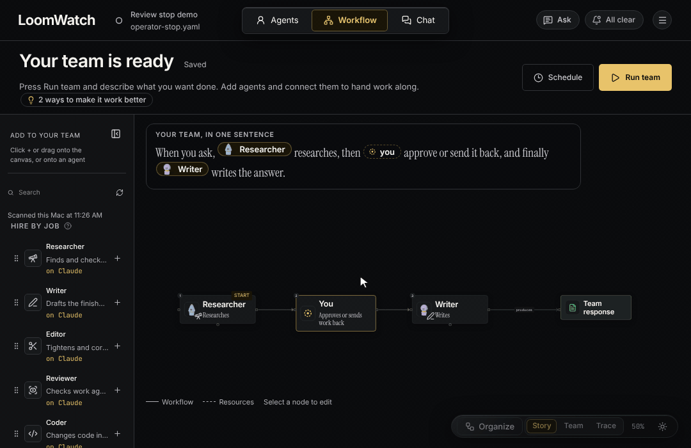
  <br>
  <sub>The bundled offline demo: ask the team in its chat, approve the handover with a note, read the answer.</sub>
</p>

**Install on a Mac** (macOS 11 or newer; nothing else to install first), then follow
[Try your first run](#try-your-first-run):

```sh
curl -fsSL https://loomwatch.github.io/install.sh | bash
```

## Your AI apps are the threads. LoomWatch is the loom.

LoomWatch runs on your computer and opens in your browser. Build each agent once and try it on its
own, connect your agents into a workflow on a canvas, then give the team work in its chat and watch
their progress, tool calls, handovers and final answer in one place. Run a single agent, a
step-by-step pipeline, or a team that delegates work as it goes. When the team needs you, it stops
and asks.

<p align="center">
  <sub>WORKS WITH THE AI APPS YOU ALREADY USE</sub><br>
  <strong>Claude Code</strong> &nbsp;·&nbsp; <strong>Codex</strong> &nbsp;·&nbsp; <strong>OpenCode</strong> &nbsp;·&nbsp;
  <strong>Hermes</strong> &nbsp;·&nbsp; <strong>OpenClaw</strong><br>
  <sub>and, through OpenCode, models such as DeepSeek, Kimi, GLM, Qwen and Mistral</sub>
</p>

## How it works

<table>
<tr>
<td width="50%" valign="middle">
<picture>
  <source media="(prefers-color-scheme: dark)" srcset="site/assets/app/agents-dark.webp">
  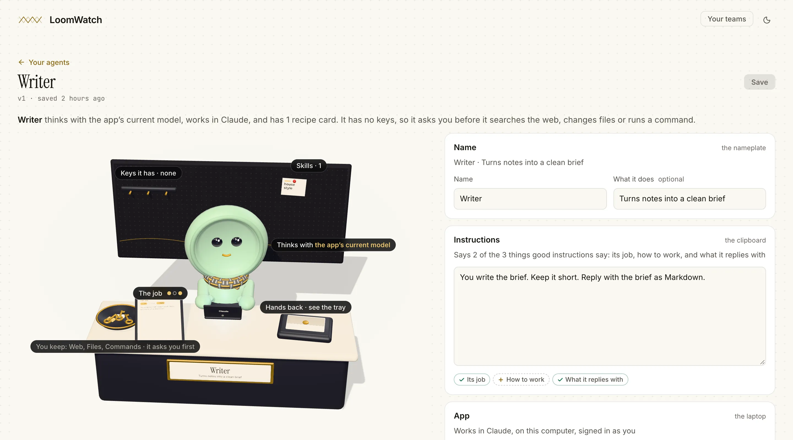
</picture>
</td>
<td width="50%" valign="middle">

### 01 &nbsp;Agents

**Build an agent** once: its job, the AI app and model it thinks with, its skills, and the keys it
may use without asking, such as the web or running commands. Pick it a face, **try it on its own**
with a real request, and save it to **Your agents**. Change its job later and it becomes the next
version; a team keeps the version it was given until you choose **Update**.

</td>
</tr>
<tr>
<td valign="middle">

### 02 &nbsp;Workflow

Put your agents in a team, or hire one by job, and connect who hands work to whom on a canvas.
LoomWatch reads the team back to you in **one plain sentence**, so you can check the plan before
anything runs.

</td>
<td valign="middle">
<picture>
  <source media="(prefers-color-scheme: dark)" srcset="docs/assets/readme/step-build-dark.png">
  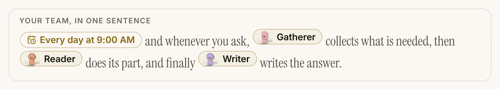
</picture>
</td>
</tr>
<tr>
<td valign="middle">
<picture>
  <source media="(prefers-color-scheme: dark)" srcset="docs/assets/readme/step-watch-dark.png">
  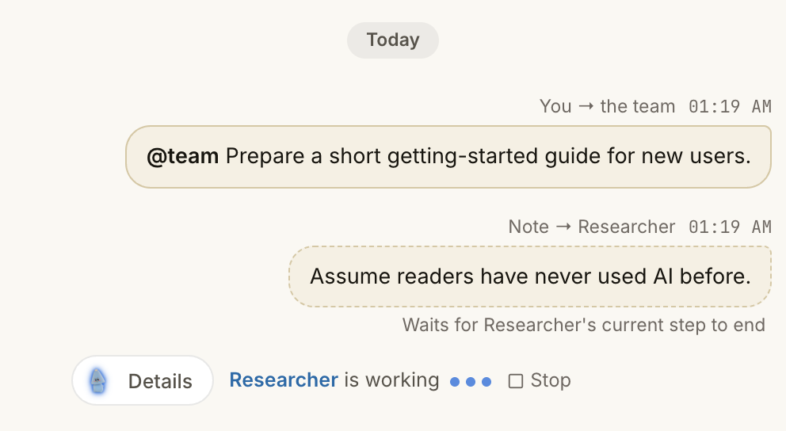
</picture>
</td>
<td valign="middle">

### 03 &nbsp;Chat: ask, and watch

Each team has one chat. Write **@team** and the job in plain words: _"@team Prepare today's AI and
tech news digest, and link every claim."_ Each stage starts when the one before it hands over, and
what the agents tell each other shows in the chat as they say it. A note you write while an agent
works joins its next turn, each agent's status is said in words beside its face (_"Writing its
reply"_, _"Waiting for you"_), and every handover lands on a **live timeline** in Details that you
can drag back to replay.

</td>
</tr>
<tr>
<td valign="middle">

### 04 &nbsp;Review

A **You** step pauses the team, and the handover waits in the chat with **Approve** and **Send
back** on it. Approve it, or write what should change and send it back. **Nothing moves on until
you decide**, and the finished answer comes with the evidence to check before you use it.

</td>
<td valign="middle">
<picture>
  <source media="(prefers-color-scheme: dark)" srcset="docs/assets/readme/step-review-dark.png">
  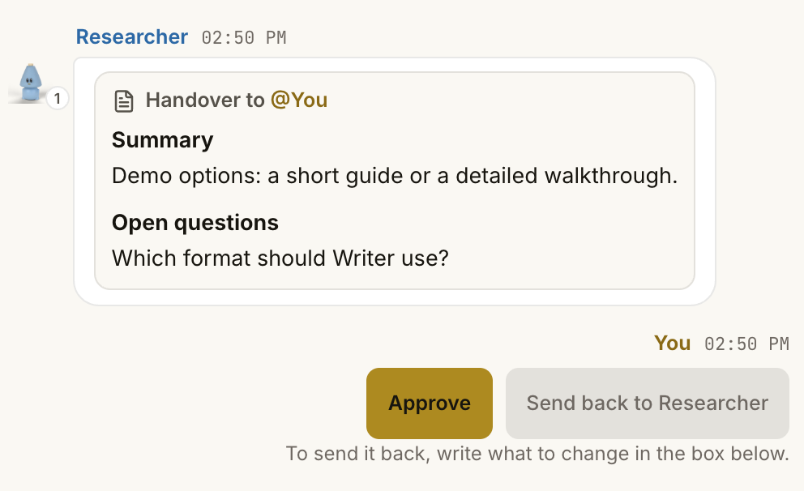
</picture>
</td>
</tr>
</table>

## LoomWatch is right for you if

- ✅ You use one or more AI apps, such as Claude Code, Codex or OpenCode, and want them to **work on
  one job together**.
- ✅ You want to **build an agent once, try it on its own**, and reuse it in every team that needs it.
- ✅ You want to **see what each agent did**, not just read a final answer: every tool call, file and
  handover is recorded.
- ✅ You want to **approve or redirect work** before the next agent builds on it.
- ✅ You want it **on your own computer**, with the skills and MCP tools you already have.
- ✅ You run the same kind of job again and again, such as a daily digest or a research brief, and
  want it **repeatable, or scheduled**.

## What changes when your apps work as a team

| Without LoomWatch | With LoomWatch |
| --- | --- |
| You copy one app's answer into the next app's prompt. | Agents hand work to each other, and every handover is on the timeline. |
| You find out what an agent did by scrolling back through its terminal. | Every message, tool call and file it touched is recorded, and you can replay it. |
| A weak first step quietly shapes everything after it. | A review step stops the team until you approve, or send the work back. |
| Each app has its own skills, tools and folders. | Skills, MCP tools and the folders and files you choose are delivered to the agents that need them. Take one off and it is turned off for that agent. |
| You set the same agent up again in every project. | Build it once in Your agents, try it on its own, and add it to any team. Teams keep their version until you choose Update. |
| Doing the job again means retyping the prompt. | One chat per team that remembers the conversation, **@** an agent to redo one step, and daily schedules. |

## How a run works

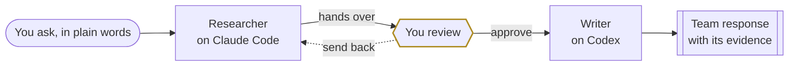

Each agent is its own AI app, started by LoomWatch on your computer and driven over
[ACP](https://agentclientprotocol.com) (the Agent Client Protocol). Agents can hand work to each
other, or ask each other questions, through LoomWatch's Team Bus. Every message, tool call and
handover is recorded in a local database, so you can watch a run live, replay it later, and follow
up from any step.

### Three ways to run a team

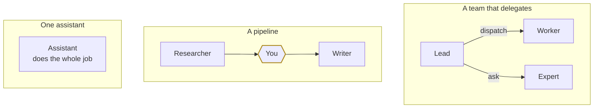

**One assistant** does the whole job. **A pipeline** runs its stages in order, each one receiving
the last one's handover, with review stops wherever you put them. **A team that delegates** starts
with a lead that hands out work and asks its teammates questions as it goes.

## Features

<table>
<tr>
<td width="33%" valign="top">

### 🧑‍🔧 Your agents

Build an agent once: its job, app, model, skills and the keys it may use. Try it on its own on a
test bench, then add it to any team. A new job makes a new version, and teams keep theirs until you
choose **Update**.

</td>
<td width="33%" valign="top">

### 🧶 A face for every agent

Pick each agent a figure from a sewing-box crew and a colour. It is the same on the canvas, in the
team sentence, in the chat and in Details, and it moves only as the run record says.

</td>
<td width="33%" valign="top">

### 🩺 Make it work better

Each agent's panel suggests what would help, read from the team file and its last five runs, each
with a one-click fix, and says about how many tokens a run uses.

</td>
</tr>
<tr>
<td valign="top">

### 🧵 One team, many apps

Each agent runs on its own app and model: Claude Code researches, Codex reviews, OpenCode writes on
a free model. Each agent uses its own app's sign-in or API key, under that provider's terms.

</td>
<td width="33%" valign="top">

### 🗺️ Connect a workflow

Add agents from **Your agents** or hire them by job, connect them in order, and read your team back
as one plain sentence before anything runs.

</td>
<td width="33%" valign="top">

### 👀 Watch every step

Live stages, tool calls, each agent's status in words, a team chat of what the agents said to each
other, and a run receipt stamped with how the run ended and the tokens it used. Drag the timeline to
replay what happened, and when.

</td>
</tr>
<tr>
<td valign="top">

### ✋ You stay in the loop

Add a **You** step to approve the work or send it back with changes. Agents can also stop and ask you
a question mid-run. In **Auto** mode, commands that only read or download run without asking.

</td>
<td valign="top">

### 🧾 Evidence you can check

A skill shows as loaded only when it was actually sent, and as opened only when the agent's own
stream read it. Nothing is guessed from a title.

</td>
<td valign="top">

### 🧰 Your skills, tools and files

Wire in the skills and MCP tools already on your computer, and give an agent any folder or file,
PDFs included once `pdftotext` is installed (`brew install poppler`). LoomWatch delivers each one
to the agents you choose, and turns off what you take off the canvas.

</td>
</tr>
<tr>
<td valign="top">

### 🧠 Team memory

A **Brief** of shared instructions and files, and a **Notebook** of reusable notes and checkpoints
that carry from one run to the next.

</td>
<td valign="top">

### 💬 One chat per team

Write **@team** to start everyone, **@Writer** to ask one agent, or a note the team reads next time.
A note to an agent at work goes into its next turn, so it revises with everything it already has.

</td>
<td valign="top">

### ⏰ Schedules and Notion

Run a team every morning and send the answer to Notion. A review stop still waits for you. Give an agent a Notion page to read by dragging Notion onto it.

</td>
</tr>
<tr>
<td valign="top">

### 💬 Ask LoomWatch

Describe the team you want in a sentence. One of your own AI apps sets it up on the canvas, and
nothing is saved until you click **Apply**.

</td>
<td valign="top">

### 🎓 Guided first run

An offline demo team and a three-minute guide. You can learn the whole app before you connect an AI
account.

</td>
<td valign="top">

### 🔒 Runs on your computer

The app, your teams and your run history stay on this computer. Agents' apps still talk to their own
model providers, as they always do.

</td>
</tr>
</table>

## Teams you can build

Every team below is made from the jobs under **Hire by job** in Workflow's add panel, each on the AI
app it suits, or from agents you built in **Your agents**. Start from **New team**, then add, connect
and rename agents to match. To run a team on a schedule, ask
[Ask LoomWatch](#ask-loomwatch-to-set-up-a-team) to add one, or see [Routines](docs/WATCH.md#routines).

| Team | The steps | Good for |
| --- | --- | --- |
| **Morning briefing** | ⏰ Every day at 10:00 → Collector → Editor → Writer → Notion | A digest that is waiting when you start work |
| **Research and review** | Researcher *(OpenCode)* → Reviewer *(Claude Code)* | Answers whose sources a second agent has checked |
| **Approve before writing** | Researcher → ✋ **You** → Writer | Anything where a wrong first step is costly |
| **Code with a second opinion** | Coder *(Codex)* → Reviewer *(Claude Code)* → ✋ **You** | Changes in a folder, checked before you keep them |
| **From numbers to slides** | Analyst *(Codex)* → Designer *(Claude Code)* | A deck or page built from real data |

## See it

<table>
<tr>
<td align="center">
<picture>
  <source media="(prefers-color-scheme: dark)" srcset="site/assets/app/home-dark.webp">
  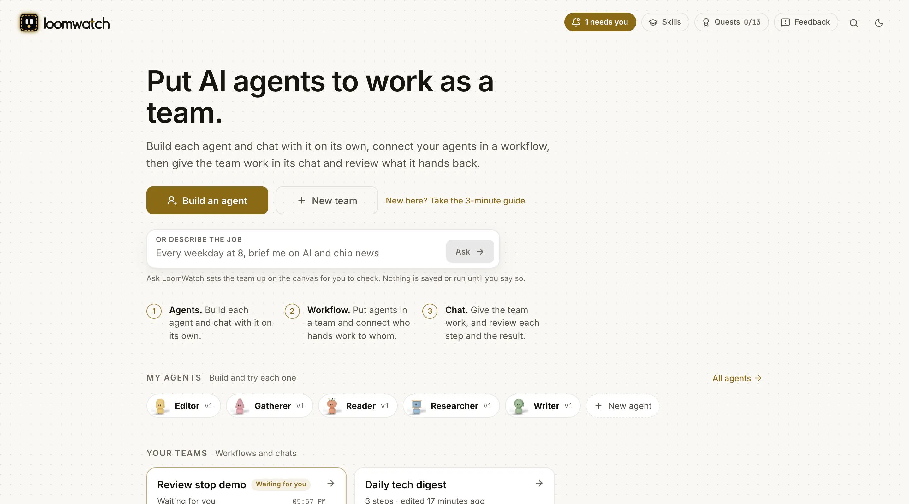
</picture>
<br><sub><strong>Home.</strong> Your agents first, each with its face and version, then the teams they work in.</sub>
</td>
</tr>
<tr>
<td align="center">
<picture>
  <source media="(prefers-color-scheme: dark)" srcset="site/assets/app/workflow-dark.webp">
  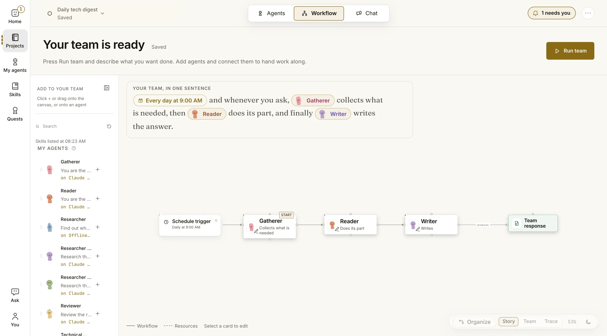
</picture>
<br><sub><strong>Workflow.</strong> Your agents on the canvas, connected in order and read back as one sentence.</sub>
</td>
</tr>
<tr>
<td align="center">
<picture>
  <source media="(prefers-color-scheme: dark)" srcset="site/assets/app/chat-dark.webp">
  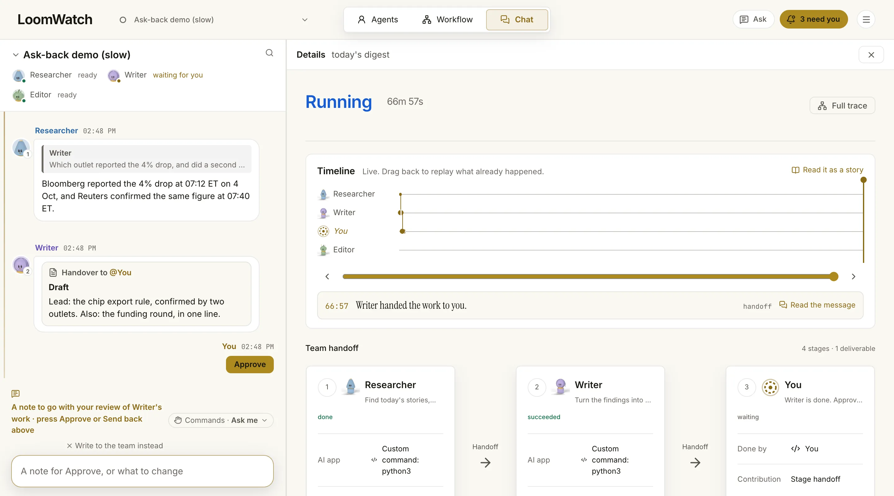
</picture>
<br><sub><strong>Chat.</strong> What the agents say to each other, your review, and the record one pane away in Details.</sub>
</td>
</tr>
</table>

## What LoomWatch is not

- **Not a chatbot.** It runs teams of the AI apps you already have, one app per agent.
- **Not a cloud service.** It runs on your computer and keeps your run history there.
- **Not a model provider.** Your agents use your own AI apps and accounts.
- **Not autopilot.** You choose where the team stops for your review, and it waits for you.

## Quickstart

On a Mac, paste this into Terminal:

```sh
curl -fsSL https://loomwatch.github.io/install.sh | bash
```

It downloads LoomWatch (about 21 MB, one program for Apple silicon and Intel Macs), checks it
against the release's checksum, puts it in `~/LoomWatch/app`, and opens
**<http://127.0.0.1:3000>** with an offline demo team ready to run. Nothing is compiled and no
administrator password is needed. Then follow [Try your first run](#try-your-first-run).

> [!TIP]
> No AI account yet? The offline demo needs no API key and no model usage, so you can learn the whole
> app first.

<details>
<summary>Rather read the installer before running it?</summary>

```sh
curl -fsSLO https://loomwatch.github.io/install.sh
less install.sh
bash install.sh
```

It is [scripts/install.sh](scripts/install.sh) in this repository. It downloads
`loomwatch-macos-universal.tar.gz` and its `.sha256` from the
[newest release](https://github.com/tnghia903/loomwatch/releases/latest), and changes nothing
outside `~/LoomWatch` apart from a `loomwatch` shortcut in `~/.local/bin` when that folder is
already on your `PATH`.

</details>

LoomWatch runs on your computer as one program, and keeps your run history in one file there. That
way it can use the AI apps, skills, MCP tools, sign-ins and folders already set up for your user
account.

### What you need

- **A Mac** with macOS 11 or newer. Linux downloads exist for x86_64 and arm64 but are untested.
  Windows is not supported yet.
- **For real runs, one AI app** installed and signed in: Claude Code, Codex or OpenCode, for
  example. OpenCode has free models and needs no account. You don't need any for the demo, and the
  home screen's **Set up an AI app** gives each app's install and sign-in commands.

The offline demo runs on Python 3. On a Mac without Apple's Command Line Tools, macOS offers to
install them the first time the demo runs; say yes, or install them first with
`xcode-select --install`.

> [!NOTE]
> Gemini CLI no longer works with a personal Google sign-in. Google now refuses it ("This client is
> no longer supported"), and LoomWatch shows Gemini as not working once that happens. Gemini CLI
> signed in with a Gemini API key may still work, but LoomWatch has not been tested that way.

Start LoomWatch from a terminal where your AI app's command already works, because LoomWatch finds
your apps, skills and tools through it.

### What the first start does

1. Creates your teams folder, `~/LoomWatch/teams`, with an offline demo team in it, if the folder
   does not exist yet.
2. Starts LoomWatch and opens **<http://127.0.0.1:3000>** in your browser.
3. Keeps your run history, notes and checkpoints in one file,
   `~/Library/Application Support/LoomWatch/loomwatch.db` (`~/.local/state/loomwatch` on Linux), so
   they survive restarts and reinstalling.

Coming from a version that kept the run history in Docker? The first start after the update copies
it into the file and leaves the Docker database as it was. If Docker is not running then, the
terminal says how to do it later: `~/LoomWatch/app/loomwatch import`.

Keep the Terminal window open while you use LoomWatch. To stop LoomWatch, press
<kbd>Ctrl</kbd>+<kbd>C</kbd> in it.

LoomWatch looks for your skills and tools in the usual places in your home folder (`.claude`,
`.codex`, `.agents`, `.config/opencode` and similar) and for AI apps on the terminal's `PATH`. It
reads them only on your computer; nothing is uploaded.

### Every day

| To | Run |
| --- | --- |
| Start LoomWatch, or open it if it is already running | `~/LoomWatch/app/loomwatch` |
| Stop LoomWatch | Press <kbd>Ctrl</kbd>+<kbd>C</kbd> in its window, or run `~/LoomWatch/app/loomwatch stop` |
| Update to the newest release | **Update and restart** in the app, or `~/LoomWatch/app/loomwatch update` |
| Go back to the version the last update replaced | `~/LoomWatch/app/loomwatch rollback` |
| See which version you have, and whether a newer one is out | `~/LoomWatch/app/loomwatch version` |
| See every option | `~/LoomWatch/app/loomwatch help` |

When the installer added the `loomwatch` shortcut, plain `loomwatch` works too. Your teams and
history are kept in every case.

### Updating

LoomWatch checks once a day, and again right after you update, whether a newer release is out.
When one is, Home shows **Update available** and the terminal running LoomWatch says so too. Click
it to read what changed and how to install it; <kbd>⌘</kbd><kbd>K</kbd> → **Check for updates…**
opens the same window at any time. Nothing is installed until you ask for it, in either of two ways:

- Click **Update and restart**. LoomWatch asks first, naming any team still working, since updating
  stops it. Then it stops, updates, and starts again in the same terminal window, and the page says
  when the new version is running. Keep that window open meanwhile.
- Or, in the terminal: press <kbd>Ctrl</kbd>+<kbd>C</kbd> in LoomWatch's window, then run
  `~/LoomWatch/app/loomwatch update` there.

Both first save a copy of your run history in `~/LoomWatch/backups` (the three newest copies are
kept; each is a database file you can open). Then they download the release, check it against the
release's checksum, and start it. If
any step fails, the version you had stays as it was, and the terminal says why; after **Update and
restart**, it also starts again and the app says why.
Run `update` while LoomWatch is running and it asks before stopping it. Already on the newest
release, it only starts LoomWatch.

**Update and restart** is there when LoomWatch was started with `~/LoomWatch/app/loomwatch` (or
`loomwatch`), which stays beside it to start it again. Versions 0.1.9 and older don't have it: update
those once in the terminal.

The version an update replaced is kept. If the new one gives you trouble,
`~/LoomWatch/app/loomwatch rollback` puts it back. When the newer version changed how the run
history is stored, the older one cannot read it, so `rollback` also puts back the copy saved before
the update. It asks first, and saves what you recorded since in another copy. Going back to a
version that kept the run history in Docker finds that history there, as the update left it; what
you ran since stays in the file. To install one particular release, run
`LOOMWATCH_VERSION=v0.1.4 ~/LoomWatch/app/loomwatch update`.

The daily check asks GitHub for the newest version number and sends nothing about you, your teams
or your runs. Turn it off in the **Check for updates** window, or for good on this computer with
`LOOMWATCH_UPDATE_CHECK=off`. Running the install command again also updates LoomWatch, without
the copy of the run history.

To stop one run, click **Stop** beside the request box. Closing the browser tab does not stop LoomWatch or
its runs. Scheduled teams run only while LoomWatch is running and the computer is awake. For scheduled runs and optional Notion delivery, see [Routines](docs/WATCH.md#routines) and
[Notion setup](docs/NOTION.md).

### Remove LoomWatch

1. If you connected LoomWatch to other AI apps, choose **Connections…** from the ☰ menu and click
   **Disconnect** beside each one. For Claude Code, Codex and Gemini CLI this also removes LoomWatch
   from the app's own settings. For an app you pasted a snippet into, delete its `loomwatch` entry
   yourself.
2. Stop LoomWatch: `~/LoomWatch/app/loomwatch stop`.
3. Delete the program: `rm -rf ~/LoomWatch/app`, and `rm ~/.local/bin/loomwatch` if the installer
   made that shortcut.
4. Your teams are kept in `~/LoomWatch/teams` until you delete `~/LoomWatch` too. It also holds Your
   agents, deleted teams, the agents' working folders, and in `backups` the copies of your run
   history that updates saved.
5. Your run history, Notebook entries and Ask conversations, which teams you approved to run, and
   your update-check choices are in `~/Library/Application Support/LoomWatch`
   (`~/.local/state/loomwatch` on Linux). Delete that folder too to leave nothing behind.

For a copy built from source, run `./loomwatch stop` in its folder, then delete the folder: its run
history is inside it, in `.loomwatch/`.

If you used a version that kept the run history in Docker, its database is still there. Delete it,
once you no longer need it, with `cd ~/LoomWatch/app && docker compose down -v` before step 3 (or
in Docker Desktop, the `loomwatch-app_postgres-data` volume).

### Change the defaults

| Setting | Default | For example |
| --- | --- | --- |
| Browser port | `3000` (or `LOOMWATCH_PORT` in `.env`) | `LOOMWATCH_PORT=3001 ~/LoomWatch/app/loomwatch` |
| Teams folder | `~/LoomWatch/teams` | `LOOMWATCH_TEAMS_ROOT=~/Work/teams ~/LoomWatch/app/loomwatch` |
| Run history file | `~/Library/Application Support/LoomWatch/loomwatch.db` | `LOOMWATCH_DATABASE=~/Work/loomwatch.db ~/LoomWatch/app/loomwatch` |
| Install folder | `~/LoomWatch/app` | `curl -fsSL https://loomwatch.github.io/install.sh \| LOOMWATCH_APP_DIR=~/Apps/LoomWatch bash` |
| Version | The newest release | `curl -fsSL https://loomwatch.github.io/install.sh \| LOOMWATCH_VERSION=v0.1.0 bash` |
| Copies of the run history saved by `update` | `~/LoomWatch/backups` | `LOOMWATCH_BACKUP_DIR=~/Backups/LoomWatch ~/LoomWatch/app/loomwatch update` |
| Daily check for a newer version | On | `LOOMWATCH_UPDATE_CHECK=off ~/LoomWatch/app/loomwatch`, or turn it off in **Check for updates** |

`loomwatch --no-open` starts without opening the browser, and `loomwatch help` lists everything.

### Build from source

To change LoomWatch, or to run the newest code on `main`, build it yourself. That needs Git,
[Node.js](https://nodejs.org/) 22.12 or newer and [Rust](https://rustup.rs/); the exact Rust
version downloads on its own during the first build. With Homebrew:

```sh
brew install node
curl --proto '=https' --tlsv1.2 -sSf https://sh.rustup.rs | sh -s -- -y
```

Open a new terminal window so it finds the new tools, then:

```sh
git clone https://github.com/tnghia903/loomwatch.git
cd loomwatch
./loomwatch
```

The first start builds the browser app and the program, which takes a few minutes, then does what
the installed copy does. Use `./loomwatch` from that folder wherever this guide says
`~/LoomWatch/app/loomwatch`. In a copy of the source, `./loomwatch update` pulls the newest `main`,
saves a copy of the run history when anything changed, and rebuilds; `rollback` is for installed
copies, since Git keeps every version of yours. `./loomwatch --rebuild` builds again even when
nothing changed. `main` moves faster than the releases, so expect rough edges. A copy of the source
keeps its own run history in `.loomwatch/loomwatch.db` inside its folder, apart from the installed
app's. If it ran before with its database in Docker, the first start copies that history in.

<details>
<summary>What <code>./loomwatch</code> runs, if you prefer to do it by hand</summary>

```sh
(cd ui && npx --yes pnpm@12 install --frozen-lockfile && npx --yes pnpm@12 run build)
cargo build --release --locked --bin loomwatchd
mkdir -p "$HOME/LoomWatch/teams"
cp -n examples/operator-stop.yaml examples/operator-stop-harness.py "$HOME/LoomWatch/teams/"
unset LOOMWATCH_CAPABILITY_HOME LOOMWATCH_HOST_RUNNER_ADDR LOOMWATCH_HOST_RUNNER_TOKEN
./target/release/loomwatchd serve --teams-root "$HOME/LoomWatch/teams" --listen 127.0.0.1:3000 \
  --database .loomwatch/loomwatch.db
```

The browser app is built before the program because it is packed into it. The `unset` line keeps
settings meant for the Docker Compose mode below out of a local run. `loomwatchd backup <file>`
saves a copy of the run history, safely while it runs, and `loomwatchd import-postgres --from
postgres://…` copies in one an older version kept in PostgreSQL.

</details>

## Try your first run

The first time you open LoomWatch, a short guide offers to walk you through building your first
agent, trying it on its own, putting it in a team and running it with one of your own AI apps.
Reopen it any time with **New here? Take the 3-minute guide** on Home, from the menu in a team, or
by pressing <kbd>⌘</kbd><kbd>K</kbd> and choosing **Getting started guide**.

To try a team without calling a model provider, pick **Review stop demo** under **Your teams**. The
demo is a three-step workflow: **Researcher → You → Writer**. Its agents produce fixed responses so
you can learn the interface without calling a model provider.

1. Open the team's **Chat** tab (or click **Run team** in **Workflow**), type
   `@team Prepare a short getting-started guide for new users.` in the message box at the bottom,
   and press <kbd>Enter</kbd> (<kbd>Shift</kbd>+<kbd>Enter</kbd> adds a new line). Only a message
   with an **@** starts work; the box says where each message goes before you send it.
2. When the team pauses for you, the chat shows what Researcher handed over, with **Approve** and
   **Send back to Researcher** under it.
3. To ask for changes, type `Use the short guide and remove the detailed walkthrough.` in the box
   and click **Send back to Researcher**. The researcher revises its work and asks again.
4. Click **Approve** to let the team continue. To pass on a note, type it first; the button then
   says **Approve with your note**, and your note goes on as your direction.
5. Read the team's answer in the chat. The demo writer echoes the direction it received.

Everything the team has done stays in its chat: scroll up, or search it with the magnifier at the
top. **Details** on any piece opens its stages, timeline and record beside the chat, and **Full
trace** there has the replay slider. To change one step's work, write **@** and that agent's name
with what should change; under its new version, **Continue with the team** runs the steps after it.

## Run your own agents

1. Install and sign in to the AI app you want to use (Claude Code, Codex or OpenCode, for example)
   in Terminal, and confirm it works on its own.
2. Start LoomWatch from a terminal where that app is available. The bottom of the home screen
   lists the AI apps it found. If none can run, **Set up an AI app** opens on the home screen. It
   checks each app's sign-in, not just that it is installed, and says when LoomWatch needs a
   restart to use an app installed after it started.
3. Click **Build an agent** on Home. Give it a name and its instructions, choose its app and model,
   pin up the skills it needs and hand it the keys it may use without asking. Pick it a face, then
   **Try it** with a real request: it runs on that app, counts toward that app's account, and asks
   you before it uses a key it wasn't given. **Save to Your agents** when it does the job.
4. Click **New team**, give it a name and choose how it should start:
   - **One assistant** — a single agent that does the whole task (recommended to begin with).
   - **Researcher and writer** — one agent gathers facts, a second writes the result.
   - **Research, your approval, then writing** — the team pauses so you can approve the research.
   - **Empty team** — build it yourself from the library on the left.

   Ready-made teams are saved straight away with your AI app's own default model, so you can
   run them immediately.
5. A team has three tabs: **Agents**, **Workflow** and **Chat**. On **Agents**, click **Add an
   agent** to bring in one from Your agents. On **Workflow**, add more from the panel on the left:
   **Your agents**, or a job under **Hire by job**, such as Researcher or Writer, which is set up on
   the best AI app you have. For a blank agent on one app, pick that app under **AI apps**. Select a
   card to edit its name, instructions and app, or click **Model and more settings** to change its
   model. Drag from the dot on a card's right edge to the next card to make them work in order, and
   add **You (review step)** wherever you want to approve work before the team continues.
6. Click **Run team**, or open **Chat**, describe what you want in plain words, and press
   <kbd>Enter</kbd>.

LoomWatch connects to agent apps through ACP, a protocol for exchanging tasks and results.
The Library recognizes these integrations:

| Agent app | Connection used by LoomWatch |
| --- | --- |
| Claude | `claude-agent-acp`, with an `npx` bridge fallback |
| Codex | `codex-acp`, with an `npx` bridge fallback |
| Gemini | `gemini --acp` (API key sign-in only; untested) |
| OpenCode | `opencode acp` |
| Hermes | `hermes-acp` |
| OpenClaw | `openclaw acp` |

LoomWatch also recognizes pi, but cannot run it: pi has no ACP connection. Use its models through
OpenCode instead.

Bridge fallbacks may download a package on first use. Availability in the Library means
the required commands were found; it does not confirm that your account is signed in or
has model access. Delegation and session-resume support vary by integration.

> [!IMPORTANT]
> Provider authentication stays with your agent app. Real runs use your existing provider account
> and its usage limits or billing. Check each provider's terms for using its app through other
> tools. The offline demo does not consume that usage. Agent apps may send
> prompts and files to their configured model providers; running LoomWatch locally does not make
> cloud models offline.

<details>
<summary><strong>Keep the pipeline easy to follow</strong></summary>

Choose **Organize** from the ☰ menu at the top right (or press <kbd>⌥</kbd><kbd>⌘</kbd><kbd>L</kbd>,
or choose **Organize pipeline** in <kbd>⌘</kbd><kbd>K</kbd>) to arrange stages from left to right
and group skills and sources below their agents. The view then fits the arranged team. **Undo
organize**, in the same menu, restores the previous arrangement. Positions are saved with the canvas
layout; organizing does not change the workflow or start a run.

</details>

<details>
<summary><strong>Connect skills, knowledge and tools</strong></summary>

The add panel on the left of **Workflow** lists the skills and MCP tools found on your computer,
and the teams whose memory you can share. Add one to the canvas, then drag from an agent to it, or
open the card's **Details & connections** and tick the agents that should use it. To give an agent
a folder or a file, select the agent and click **Folder** or **File** under **Given** in its
**Context**. Save the team, and the next run delivers it:

- A **skill** is copied into the agent's working folder and its instructions are given to the agent.
- A **folder or file** is given to the agent as reference material: a folder's listing and README,
  or a file's text. A PDF's text is read when `pdftotext` is installed (`brew install poppler`).
  The agent can also read the folder or file itself. An added file can be up to 25 MB; link a
  folder for anything bigger.
- A **tool** is your own MCP server, handed to that agent's app with the settings you already gave it
  in Claude Code, Codex or OpenCode.

Taking a skill or tool card off the canvas, or the line from it to one agent, **turns it off** for
that agent, even the copy its own app would load by itself. The agent's **Context** lists what is
turned off, with a button to turn each back on, and under **Also from** its app, what the app brings
of its own, each with a button to turn it off. For Claude Code agents this covers skills, tools and
claude.ai connectors; for Codex agents, skills. Codex's own MCP servers can't be turned off yet, and
the panel says so. When an agent's instructions still name what you removed, LoomWatch marks it, and
**Rewrite with** your Ask app drops or rewrites just those sentences as one edit you can keep or put
back.

If something cannot be delivered (for example, a tool that is turned off in your app's settings),
the run stops before it starts and says what to change. If an older team shows "drawn but not
delivered to agents yet" at the top of Workflow, click **Deliver on the next run**, then save.

</details>

<details>
<summary><strong>Give the team context and review its work</strong></summary>

Choose **Team memory** from the ☰ menu to add shared instructions or reference files to the
**Brief**. Use the **Notebook** to review reusable notes and checkpoints.

Select an agent in Workflow to see its **Context**: its place in the team (for example "Step 2 of 3 ·
after Researcher · hands its work to Writer"), the team Brief, and every skill, folder, file and
tool connected to it, each with an × to disconnect it. In a team of two or more, each agent is told
its place at the start of every run. In the Run view, an agent's **What this agent received** link
(**What it was given** on its card in Full trace) shows what it was supplied when its session
started.

For a review checkpoint in a pipeline, add a **You** step between two agents and say what to look
at in its **What to check** box. **Approve** passes the work on (it says **Continue** once you
type a note, and your note goes with it). **Send back to** the agent asks for a revision while its
session is still open. An agent can also ask you a question mid-run: type your answer in the
request box and click **Reply**.

</details>

## Ask LoomWatch to set up a team

Click **Ask** at the top of any screen (or press <kbd>⌘</kbd><kbd>J</kbd>), or type in **Or describe
the job** on Home. Say what you want in plain words, such as _"Every weekday at 8, brief me on AI
news"_. One of your own AI apps sets the team up on the canvas. New and changed agents are marked,
and nothing is saved until you click **Apply**; **Discard** drops the proposal, and **Undo** takes
an applied one back.

- **It asks before it runs.** When it wants to start a run, it waits for you to click **Start run**,
  unless you turn off **Ask me before starting a run**.
- **It never answers a review step.** It can put a drafted note in the review box; only you click
  **Approve** or **Send back**.
- **You choose the app.** The panel says which app it is using ("Using Claude on this computer").
  Click the app's name to pick another, and a model under it. Ask can use Claude Code, Codex,
  OpenCode or Hermes. Each conversation counts toward that app's account, like a run.

<details>
<summary><strong>Use LoomWatch from your other AI apps</strong></summary>

Choose **Connections…** from the ☰ menu (or from <kbd>⌘</kbd><kbd>K</kbd>). Under **Use LoomWatch
from your AI apps**, **Connect** registers LoomWatch with Claude Code, Codex, Gemini CLI or VS Code
using that app's own command, which you can read under **What LoomWatch runs** first. OpenCode and
Claude Desktop get a snippet to paste instead; it holds a private key, so don't share it. What a
connected app proposes or starts appears in the Ask panel under **From your connected apps**.
**Disconnect** stops it at once.

</details>

## FAQ

<details>
<summary><strong>Do I need an account or an API key?</strong></summary>

Not for LoomWatch itself: it is free, has no account and never sees your sign-ins. Each agent runs
one of your AI apps, signed in the way you set that app up, and its usage counts toward your own
account with that provider. Providers set their own rules for using their apps through other
programs: Anthropic, for example, asks products built on its Agent SDK, which LoomWatch uses to
run Claude Code, to use an API key (see
[Authentication and credential use](https://code.claude.com/docs/en/legal-and-compliance#authentication-and-credential-use)).
To run Claude agents on an API key, start LoomWatch from a terminal where `ANTHROPIC_API_KEY` is
set.

The offline demo needs no AI account at all, and OpenCode runs real agents on its free models
without one. Free models change often, and some let their maker learn from what you send, so keep
private work for a model you pay for.

</details>

<details>
<summary><strong>What does a run cost?</strong></summary>

Real runs use your AI apps' own accounts, so they count toward those accounts' usage limits or API
billing, under each provider's terms. The offline demo uses none.

</details>

<details>
<summary><strong>Is my work sent anywhere?</strong></summary>

LoomWatch serves everything on `127.0.0.1` and keeps your run history in a file on this computer. It reads your skills and tools only on your computer. The agents' own apps still send
prompts and files to their model providers, as they do when you use them directly.

</details>

<details>
<summary><strong>Can different agents in one team use different apps and models?</strong></summary>

Yes. Each agent card has its own app and model. A team can research with Claude Code, review with
Codex and write with OpenCode. Through OpenCode, an agent can also use models such as DeepSeek, Kimi,
GLM, Qwen or Mistral.

</details>

<details>
<summary><strong>What happens when an agent asks for permission to do something?</strong></summary>

LoomWatch decides, so every AI app follows the same rules. It puts each app in its ask-first mode and
answers every request itself. Each agent's panel in **Workflow** has three switches under **Allowed
without asking**: **Search the web**, **Edit files** (only in the agent's own folder) and **Run
commands**. They start off, except **Search the web** for researchers. LoomWatch always allows the
team's own handovers and the tools, folders and files you connected to the agent.

Anything else waits for you. The agent pauses and asks in the team chat, as its own message, such
as "Asks to use the web · Web search · …". You answer right below it: **Allow**, **Allow for this
run**, **Allow for the whole team** (every agent in this run may use that tool without asking),
**Always allow** (which switches it on for that agent) or **Deny**. The chat keeps how it
ended, such as "You allowed it, this once". The same question shows up in the Needs-you tray from
any screen. If nobody answers within 10 minutes it is declined, and scheduled runs decline it
straight away because nobody is watching.

To ask less often, switch the team to **Auto** beside the chat's message box (**Commands · Ask me**
→ **Auto**), or set `permissions: {mode: auto}` in the team file. A command an agent isn't allowed
to run on its own then runs without asking when every part of it only reads inside the agent's
folder, its knowledge or the temp folder, or is a plain download for an agent allowed the web.
Anything that deletes, pushes, publishes, deploys, needs admin rights, touches credentials or runs a
script given as text always asks, and so does everything else, with the reason on the card.
LoomWatch decides this on your computer from the command itself; no model is asked and nothing is
sent anywhere.

The run records every request and who answered it. When something was declined, the run receipt says
what the agent couldn't do and offers **Allow from now on**. OpenCode doesn't ask before it acts, so
the switches can't hold it back.

LoomWatch starts agents without the tools that publish, post or message outside the run. An agent
you allow to run commands or use the web, an OpenCode agent, or an MCP server in Codex's own
settings can still reach the internet. Claude Code can publish to your
claude.ai account, schedule work, send notifications and message your other Claude sessions without
asking, so LoomWatch starts every agent without those tools. Your team's answer leaves through your
review and the delivery you set up, such as **Send every answer to Notion**. If such a tool runs anyway,
for example on an app that ignores the rule, the run receipt flags it.

Codex brings its plugins and the apps on your ChatGPT account into every session, including the
ChatGPT app's browser and computer control, and runs any of their tools that call themselves
read-only without asking. So LoomWatch starts every Codex agent with plugins and apps switched off.
The MCP servers you added to Codex's own settings (`~/.codex/config.toml`) still load, because
LoomWatch can't switch them off through Codex's adapter yet. If an agent uses any tool LoomWatch
didn't connect to it without asking you, the run receipt flags it.

</details>

<details>
<summary><strong>Is it safe to run a team someone shared?</strong></summary>

A team file is a list of programs to start, so treat one like any script you download. LoomWatch
helps you check it. The first time you run a team that wasn't built in LoomWatch, or that changed
outside it, LoomWatch shows what it will do before anything starts:

- which app or program each agent runs, with any program LoomWatch doesn't know quoted in full;
- what each agent may do without asking;
- the folders it can read;
- whether it runs on a schedule.

Choose **Trust and run** only if you trust where it came from. Until then its schedule does
nothing. A team file also can't change what an app loads or where it connects, for example with
`NODE_OPTIONS` or a proxy. See [SECURITY.md](SECURITY.md) for what LoomWatch does and doesn't
protect against.

</details>

<details>
<summary><strong>Can I run it on a server, or entirely in Docker?</strong></summary>

Yes. See [Run everything with Docker Compose](#optional-run-everything-with-docker-compose). The
recommended desktop setup runs LoomWatch itself on your computer so it can use the apps, skills and
sign-ins already there.

</details>

## Optional: run everything with Docker Compose

Use this mode for CI, demos, or an intentionally isolated Linux deployment. It is not the
recommended desktop setup: a container cannot automatically see host executables, skills, MCP
configuration, credentials, or arbitrary host workspace paths.

<details>
<summary>Set up the Compose stack</summary>

Create your settings file with `cp .env.example .env` and replace the `replace-with-…` value with
long random letters and numbers. Then create a repository-local teams folder, and build and start
the stack:

```sh
mkdir -p teams
cp -n examples/operator-stop.yaml examples/operator-stop-harness.py teams/
docker compose up --build --detach --wait
```

Open the [offline review-stop demo](http://127.0.0.1:3000/?path=operator-stop.yaml). The UI is
embedded in the `loomwatch` image, the run history, context packets, Notebook entries and
checkpoints are one SQLite file in the `loomwatch-home` volume, and the app is published only on
host loopback. To stop, finish or stop active runs, then run `docker compose stop`: it preserves
the volume, and `docker compose up --detach --wait` resumes the stack.

The defaults mount these explicit roots:

| Container path | Default host path | Access | Purpose |
| --- | --- | --- | --- |
| `/data/teams` | `./teams` | Read/write | Team YAML, Brief files, layouts, and managed `.loomwatch` workspaces |
| `/workspaces` | `./container/workspaces` | Read/write | Repositories used by container-native agents |
| `/opt/loomwatch/capabilities` | `./container/capabilities` | Read-only | Skills and plugin metadata intentionally imported for discovery |
| `/home/node` | `loomwatch-home` volume | Read/write | Harness credentials, mutable CLI state, and the run history |

</details>

<details>
<summary>Use harnesses installed on the host</summary>

A Linux container cannot execute a macOS or Windows binary, so LoomWatch uses a narrow native
runner instead of mounting your home directory or Docker socket. Set a random
`LOOMWATCH_HOST_RUNNER_TOKEN` in `.env`, then start the companion from the repository in a host
terminal:

```sh
./container/run-host-runner.sh
```

Keep that terminal open and start the Compose stack normally in another terminal. The Library now
shows the harnesses found on the host. Agents added from those rows use an internal
`loomwatchd harness-client` command: model discovery and runs stream over the same authenticated
connection to the native ACP adapter. The runner accepts only LoomWatch's known ACP harnesses and
maps working directories only beneath `/data/teams` and `/workspaces` back to their configured host
bind mounts.

The runner listens on `0.0.0.0:3031` so Docker Desktop's `host.docker.internal` gateway can reach
it. It requires the token on every connection. If port 3031 is already used, change both
`LOOMWATCH_HOST_RUNNER_LISTEN` and `LOOMWATCH_HOST_RUNNER_ADDR` in `.env`.

Override the three bind-mounted host directories in `.env`. Do not point the capability import at
your complete home directory. Its README documents the expected `.codex`, `.claude`, `.agents`, and
OpenCode subdirectories.

</details>

<details>
<summary>Harnesses and skills in the container</summary>

The Library combines harness commands executable inside the container with harnesses reported by a
reachable native companion; host entries win when both environments provide the same app. The base
image includes Node.js, Python, Git, curl, and everything needed by the offline demo, but it does
not bundle third-party provider CLIs. Without the native companion, build a derived image with the
required Linux harnesses or install user-scoped CLI packages into the persistent runtime home. The
image's `PATH` includes `/home/node/.local/bin`.

Authenticate from the same runtime after installing a harness:

```sh
docker compose exec loomwatch sh
npm config set prefix "$HOME/.local"
# Install and authenticate only the provider CLIs you intend to use.
```

Import skill definitions through `container/capabilities`, preserving their conventional paths.
Imports are read-only; LoomWatch copies only a skill explicitly wired to an agent into that team's
managed workspace. Do not put provider tokens, SSH keys, or other credentials in the import.

Team files running against a mounted repository should use a path below `/workspaces`. Absolute
host paths such as `/Users/name/project` do not exist inside the Linux container.

</details>

## Where your work is saved

| Data | Location in this guide |
| --- | --- |
| Team definitions and canvas layouts | `~/LoomWatch/teams`; Compose-only deployments use `LOOMWATCH_TEAMS_DIR` |
| Brief files | Paths configured by the team, usually beside its YAML file |
| Deleted teams | `.trash` inside your teams folder, one folder per deleted team |
| Your agents | `.jobs` inside your teams folder, one `<agent>.yaml` per agent. Earlier versions are in `.jobs/.versions/<agent>/`, removed agents move to `.jobs/.removed`, and the one-agent teams that **Try it** runs are in `.jobs/.bench` |
| Files you add to an agent (**File** under **Given**) | `<team>.files/` beside the team file |
| Agents' working folders, and Ask's | `.loomwatch/` inside your teams folder |
| AI apps you connected to LoomWatch | `.loomwatch/connections.json` in your teams folder. It holds each app's private key. |
| Team chats (your messages and every run), recorded events, Notebook entries and Ask conversations | One file, `loomwatch.db`, in `~/Library/Application Support/LoomWatch` on macOS or `~/.local/state/loomwatch` on Linux. A copy of the source keeps its own in `.loomwatch/` in its folder; Compose deployments in the `loomwatch-home` volume. |
| Which team files you approved to run, and your update-check choices | `~/Library/Application Support/LoomWatch` on macOS, `~/.local/state/loomwatch` on Linux |
| Copies of the run history saved by `loomwatch update` | `~/LoomWatch/backups`, one folder per copy of LoomWatch, the three newest in each |
| The version the last update replaced, for `loomwatch rollback` | `.previous` in `~/LoomWatch/app` |
| Provider sign-in | Managed by each host agent app; Compose-only deployments use `loomwatch-home` |

Back up your teams folder and the run history if you want to move or preserve your work. Copy the
history while LoomWatch runs with `~/LoomWatch/app/bin/loomwatchd backup ~/loomwatch-copy.db`, or
copy `loomwatch.db` while it is stopped.

> [!WARNING]
> In Compose mode, avoid `docker compose down -v` for normal shutdown: it deletes the
> `loomwatch-home` volume, including the run history and Notebook entries.

<details>
<summary>Deleting and restoring a team</summary>

To delete a team, choose **Delete team…** from its **…** menu on Home or from the team switcher.
LoomWatch refuses while the team is running, or while another team reads its memory. Nothing is
erased. The team file, its layout, its own notes folder (`<team>.brief`) and the folder of files
added to its agents with **Add file…** (`<team>.files`) move to `.trash/<date>-<team>/` inside your
teams folder; `moved` in that folder's `deleted.json` lists which of them the team had. Its run
history and Notebook entries stay in the run history, and no new team takes its file name while it is
in the trash. To restore it, move everything in that folder except `deleted.json` back to the
folder where `path` in `deleted.json` says the team file was. `<team>.files` must go back too, or
its agents lose the files added to them. In Finder, press <kbd>⌘</kbd><kbd>⇧</kbd><kbd>.</kbd> to show hidden folders. To remove a team for good,
delete its folder from `.trash`.

</details>

<details>
<summary>Reusing an agent with Your agents</summary>

Build an agent in **Your agents** (**Build an agent** on Home), or keep one that works in a team:
select it and choose **Add to Your agents**. It appears under **Your agents** in every team's add
panel, with its instructions, app, model, skills and what it may do without asking.

Placing it copies that version into the team, so a team runs exactly what it was approved with.
Saving a change to what a team copies, such as its job, makes the next version and keeps the
earlier ones; a new face keeps the version. The agent's panel in a team says when a newer version
is ready and offers **Update to v…**, **Edit in Your agents**, or **Make it this team's own** to
change it there alone. The builder lists the teams that use the agent and the version each one has.
Removing an agent from Your agents leaves the teams' copies alone. An agent is one small file, so
you can share it by copying it into another teams folder's `.jobs`.

</details>

## Troubleshooting

<details>
<summary>Something did not work? Find what you see in this table.</summary>

| What you see | What to check |
| --- | --- |
| `curl: (22) The requested URL returned error: 404` while installing | The download is briefly unavailable while a new release is published. Wait a minute and run the install command again. |
| macOS says “loomwatchd” can't be opened because Apple cannot check it for malicious software | The archive was downloaded with a web browser, which marks it for that check. Delete `~/LoomWatch/app` and install with the `curl` command in [Quickstart](#quickstart) instead. |
| LoomWatch says something needs to be installed first | Install what it lists, open a new terminal window so it picks up the new `PATH`, then run `loomwatch` again. |
| `zsh: no such file or directory: …/loomwatch` or `command not found: loomwatch` | The installer puts LoomWatch in `~/LoomWatch/app`, so start it with `~/LoomWatch/app/loomwatch`. In a copy of the source, run `./loomwatch` from its folder. |
| `permission denied: ./loomwatch` (a copy of the source) | Run `chmod +x loomwatch` once, or start it with `bash loomwatch`. |
| "Your run history from the earlier version is still in Docker" | The first start after updating could not read the Docker database an earlier version used. Start Docker Desktop, stop LoomWatch, and run `~/LoomWatch/app/loomwatch import`. Running it twice is safe: nothing is copied twice. |
| "The database … was set up by a newer LoomWatch" | You went back to an older version by hand. Run the newer one again, or `loomwatch rollback`, which puts back the copy saved before the update. |
| Another program is using port 3000 | Start LoomWatch on another port: `LOOMWATCH_PORT=3001 ~/LoomWatch/app/loomwatch`. |
| LoomWatch says another copy of LoomWatch is already running, or the page says "Couldn't list your teams" and none of your AI apps can start | An earlier copy is still running, often one whose folder you deleted before downloading LoomWatch again. Stop it with the `kill` command the message gives, then run `loomwatch` again. |
| Team file not found | Confirm the file is in your teams folder (`~/LoomWatch/teams` unless you set `LOOMWATCH_TEAMS_ROOT`). The demo link uses `?path=operator-stop.yaml`, relative to that folder. |
| Agent is missing or unavailable | Run `command -v <agent-command>` in the LoomWatch terminal. Authenticate the app, then restart LoomWatch from that same terminal. Compose-only deployments scan the container unless the native companion is running. |
| Skill or tool is missing locally | Confirm it exists below your `.claude`, `.codex`, `.agents`, `.gemini`, `.hermes`, `.openclaw` or `.config/opencode` folder, then click ↻ beside **Search** in Workflow's add panel to scan again. Check that LoomWatch was not started with `LOOMWATCH_CAPABILITY_HOME` pointing elsewhere. |
| Skill is missing in Compose | Copy its definition below `LOOMWATCH_CAPABILITIES_DIR` using the conventional harness path, then click ↻ beside **Search** in Workflow's add panel to scan again. Symlinks whose targets are outside that mounted root cannot be followed. |
| Ask says it needs an AI app | Install and sign in to Claude Code, Codex or OpenCode, then start LoomWatch again from that terminal. |
| Harness working directory is missing | Native teams should use a real host path accessible to the agent app. Container-run teams must use `/workspaces/...` and mount its host parent through `LOOMWATCH_WORKSPACES_DIR`. |
| Agent cannot perform a tool action | While the run is going, answer its question in the run or the Needs-you tray before it is declined after 10 minutes. Afterwards, read the run receipt: it says what the agent wasn't allowed to do. Click **Allow from now on**, or switch it on under **Allowed without asking** in the agent's panel in Workflow. An edit outside the agent's own folder is never allowed. |
| Build reports an unsupported Node version | Install the current Node.js from <https://nodejs.org/>, reopen Terminal, and check `node --version`. |
| UI assets are missing or look out of date | Installed copy: run `~/LoomWatch/app/loomwatch update`. Copy of the source: stop LoomWatch, then start it with `./loomwatch --rebuild`. |
| Cannot connect from another device | This setup serves runs and history only on your own computer at `127.0.0.1`. Use the browser on that computer. |

</details>

## Under the hood

| Piece | What it does |
| --- | --- |
| `loomwatchd` | One Rust program that starts each agent's app, supervises it, and serves the browser app |
| [ACP](https://agentclientprotocol.com) | How LoomWatch talks to every agent app, over its standard input and output |
| Team Bus | A tool server the agents call back into to hand work over, ask each other questions, or report |
| LoomWatch Control | The tool server Ask LoomWatch and your connected apps use to read, propose and start teams. It answers only on this computer, with a key per app |
| Event archive | One SQLite file, built into the program, holding every message, tool call and handover, so runs can be replayed |
| Browser app | React, streamed live over a WebSocket and packed into the program |

## More guides

- [Team configuration](docs/TEAM_CONFIG.md) — roles, models, working directories, and workflow rules.
- [Team memory](docs/TEAM_MEMORY.md) — Brief, Notebook, inheritance, and checkpoints.
- [Watch and replay](docs/WATCH.md) — inspecting runs, routines, and the local API.
- [Quests and the wardrobe](docs/QUESTS.md) — practices for building good agents, noticed in your own runs and rewarded with figures and accessories.
- [Architecture](docs/ARCHITECTURE.md) — technical details for developers.
- [Security](SECURITY.md) — how to report a problem privately, and what LoomWatch does and doesn't protect against.
- [Contributing](CONTRIBUTING.md) — building from source and sending a change.

## License

LoomWatch is free and open source. You can use it under either the [MIT License](LICENSE-MIT) or the [Apache License 2.0](LICENSE-APACHE), whichever you prefer. Unless you say otherwise, anything you contribute is licensed the same way, with no extra terms.

The licenses cover the code, not the LoomWatch name or logo.

The fonts packed into LoomWatch (Inter, Fraunces and JetBrains Mono) are under the [SIL Open Font License](ui/public/fonts/OFL.txt). Notices for the other open-source software inside LoomWatch are in [third-party-notices.txt](ui/public/third-party-notices.txt). The running app serves the same file at `/third-party-notices.txt`. After changing a dependency, regenerate it with `node scripts/third-party-notices.mjs`.

LoomWatch is not affiliated with, endorsed by or sponsored by Anthropic, OpenAI, Google, Notion or any other company whose apps it works with. Claude, Claude Code, Codex, Gemini and the other product names here are trademarks of their owners. They are used only to say which apps LoomWatch works with.

<br>

<p align="center">
  <picture>
    <source media="(prefers-color-scheme: dark)" srcset="docs/assets/readme/loommark-dark.svg">
    
  </picture>
  <br>
  <sub>Woven with Rust, React and ACP. Watch every thread.</sub>
</p>
